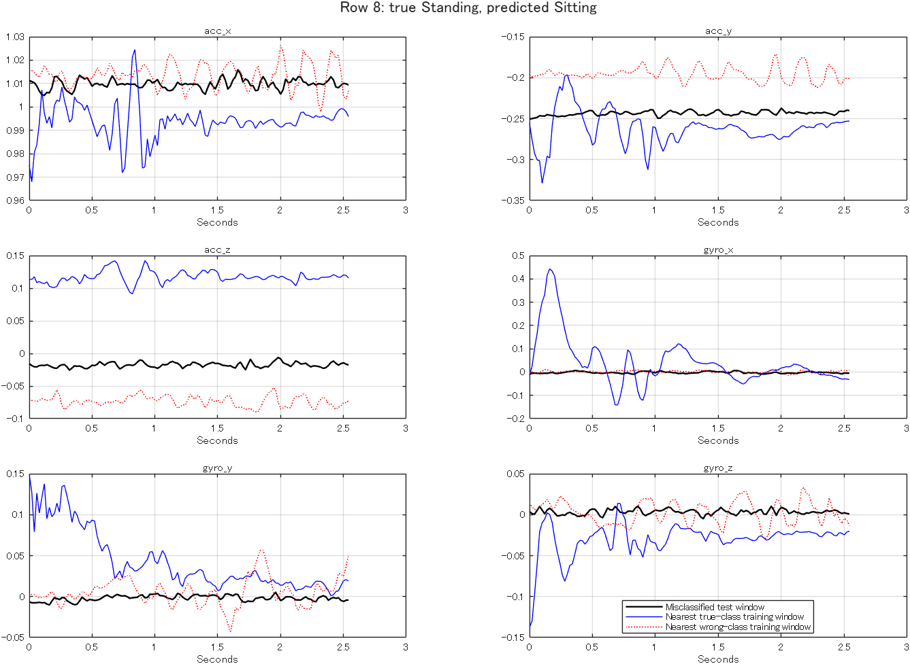
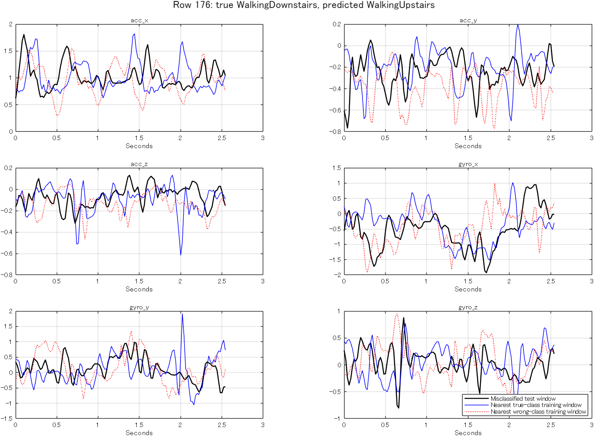

# Investigation of the five original proto_v3 errors

The requested labels are those supplied in `rawSensorData_test.mat`, not
independently re-annotated video labels. Each row is a 128-sample, 50 Hz window
(about 2.56 seconds), containing accelerometer x/y/z and gyroscope x/y/z.
No subject ID, recording ID, placement metadata, or matching per-window video
timestamps were supplied. The row numbers below are MATLAB's **1-based rows**.

## What each window represents and why the model favored the wrong class

| Row | Supplied true activity | Baseline prediction | Observed evidence and model sensitivity |
|---:|---|---|---|
| 8 | Standing | Sitting | Acceleration-y dominant frequency 5.0781 Hz, versus 0.5859 Hz median for fitting Standing windows. Replacing only this feature with the true-class training median flips the baseline prediction to Standing. |
| 10 | Standing | Sitting | Acceleration-y dominant frequency 7.0312 Hz; the same median replacement flips it to Standing. A dominant bin can be unstable in weak near-static signals. |
| 105 | Walking | WalkingUpstairs | Gyroscope-z dominant frequency 0.78125 Hz matches the upstairs median; Walking median is 2.734375 Hz. Replacing that one feature with the Walking median flips the prediction to Walking. |
| 176 | WalkingDownstairs | WalkingUpstairs | Acceleration-magnitude std is 0.2410, lower than the downstairs median 0.4028 and nearer the upstairs median 0.2677. Acceleration-x std and gyro-y/z correlation also favor the wrong decision. No single top replacement is sufficient; several features interact. |
| 201 | WalkingDownstairs | Walking | Acceleration-magnitude std is 0.2752, closer to the Walking median 0.2315 than the downstairs median 0.4028. Replacing this one feature with the downstairs median flips the prediction to WalkingDownstairs. Acceleration-x std is similarly low. |

These are measurable feature similarities and sensitivity results. They do not
prove that a person was tired, had a particular gait, or that the sensor was
misattached. Lower motion amplitude is an observation; its physical cause is
not established from these files.

## The actual decision criterion

The baseline is a nonlinear Gaussian-kernel, one-vs-one ECOC SVM. It does not
use a single hand-written threshold. MATLAB assigns the class with the largest
negated aggregate binary loss. These values are **not calibrated probabilities**.

| Row | True-class score minus predicted-class score |
|---:|---:|
| 8 | -0.050579 |
| 10 | -0.051733 |
| 105 | -0.143838 |
| 176 | -0.231700 |
| 201 | -0.111590 |

The exact six-class scores and feature sensitivities are in
`baseline_errors.json`. Each `row_NNN_features.csv` records the observed value,
fitting-class medians, standardized deviation, change in true-vs-wrong score
gap under one-feature replacement, and the resulting prediction. Replacing a
feature with a labeled class median is **diagnostic only**; this operation is
never used in model inference and is not a physically realizable intervention.

`row_NNN_neighbors.csv` contains the ten nearest fitting windows in standardized
feature space. They provide context, not an exact explanation of the SVM's
support-vector decision. Waveform overlays compare the error with its nearest
true-class and wrong-class fitting examples. Their phases are not aligned.

## Improvements and data that would help

1. **Near-static posture:** de-emphasize unstable dominant-frequency bins and
   use multiple complementary posture classifiers. Collect independent Sitting
   and Standing examples with slight lean, different phone angles/placements,
   and normal small movements. Keep placement and subject IDs.
2. **Walking versus stairs:** use frequency-band energy instead of just the
   strongest bin. Collect different cadences, step lengths, and turn phases
   across level walking and both stair directions.
3. **Low-amplitude downstairs:** include slower/gentler downstairs motion,
   varied stair heights, phone placements, and transition windows. Motion-only
   amplitude augmentation is a preliminary simulation of this variation;
   it cannot replace actual independent observations.
4. **Evaluation:** collect new recordings from people absent from fitting,
   with IDs and timestamps so overlapping windows stay in the same partition.
   The current 201 windows have now been used for development and cannot serve
   as an untouched final test.

## Observed refinement progression

| Version | Change | Validation (735) | Development (201) |
|---|---|---:|---:|
| proto_v3 | Original temporal32 Gaussian SVM | 688/735 (93.61%) | 196/201 (97.51%) |
| proto_v8 | Band-power fractions replace dominant bins; C=10, scale=8 | 714/735 (97.14%) | 199/201 (99.00%) |
| proto_v9 | Fitting-only amplitude gains 1/0.8/1.2; C=1, scale=4 | 716/735 (97.41%) | 200/201 (99.50%) |
| proto_v10 | Static-candidate consensus with original tree/linear SVM | 712/735 (96.87%) | 201/201 (100%) |

v9 already corrects all original five errors; its remaining error is row 155,
Sitting predicted as Standing. For static candidates, v10 combines the primary
with the original v1 tree and v2 linear SVM. Both vote Sitting on row 155, so the
generic strict-majority rule corrects it. There is no row-155 special case.
Other windows are reevaluated too: no old correct window becomes wrong on the
201-window development set.

**The 100% target was explicitly selected using development labels.** v10 has
lower validation accuracy than v9. The unchanged validation set has also been
inspected repeatedly and is not an untouched final test. The result proves
only that this saved model classifies this supplied finite dataset correctly.

Search logs are in `../refinement/`: 336 single-SVM feature/settings trials,
168 hierarchical trials, and 180 amplitude-augmentation trials. Unsuccessful
families are retained; the final consensus is an additional model design.
All fits exclude the original validation and development windows.

Reproduce the diagnostics with `har.analyzeErrors(pwd)` and rebuild v8-v10 with
`scripts/run_prototypes.ps1 -Action train -Models proto_v8,proto_v9,proto_v10`.
Run `tests/check_refinement.m` to verify 201/201, single-window and shuffled-order
inference, original model hashes, and fitting-only augmentation provenance.

Decision-score semantics: [MathWorks ECOC predict documentation](https://www.mathworks.com/help/stats/classificationecoc.predict.html).
