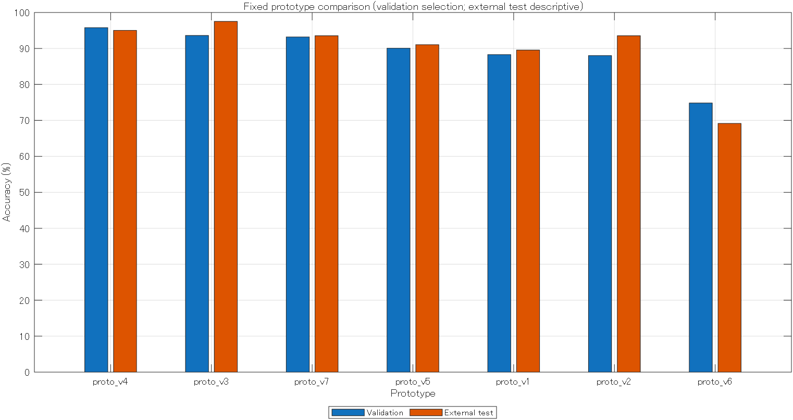

# Prototype evaluation

Selected by validation: **proto_v4**. Highest observed external test: **proto_v3**.

| Prototype | Algorithm | Features | Fit rows | Validation accuracy | Test accuracy | Test macro F1 |
|---|---|---:|---:|---:|---:|---:|
| proto_v4 | bagged_trees | 32 | 2206 | 95.78% | 95.02% (191/201) | 0.9429 |
| proto_v3 | rbf_svm | 32 | 2206 | 93.61% | 97.51% (196/201) | 0.9737 |
| proto_v7 | rbf_svm | 20 | 1320 | 93.20% | 93.53% (188/201) | 0.9212 |
| proto_v5 | knn | 32 | 1762 | 90.07% | 91.04% (183/201) | 0.9063 |
| proto_v1 | tree | 12 | 2206 | 88.30% | 89.55% (180/201) | 0.8852 |
| proto_v2 | linear_svm | 12 | 2206 | 88.03% | 93.53% (188/201) | 0.9236 |
| proto_v6 | kmeans | 32 | 2206 | 74.83% | 69.15% (139/201) | 0.6733 |

## Limitations

- Random stratified windows; no subject IDs or recording IDs provided. Overlap leakage cannot be excluded. Not an unseen-subject estimate.
- External test has 201 windows only. Comparison is descriptive, not an unbiased estimate after model selection.
- Algorithms, feature sets, and training fractions differ; results do not isolate the causal effect of algorithm choice.
- Prototypes are not official submission bundles. Organizer verifier not supplied.

No hyperparameters were tuned after viewing external test results. All models retain their original fitting subsets; no full-data refit is mixed into the comparison.
The test windows have no subject/recording identifiers. Window-level accuracy does not establish performance on unseen people or on the hidden contest set.
