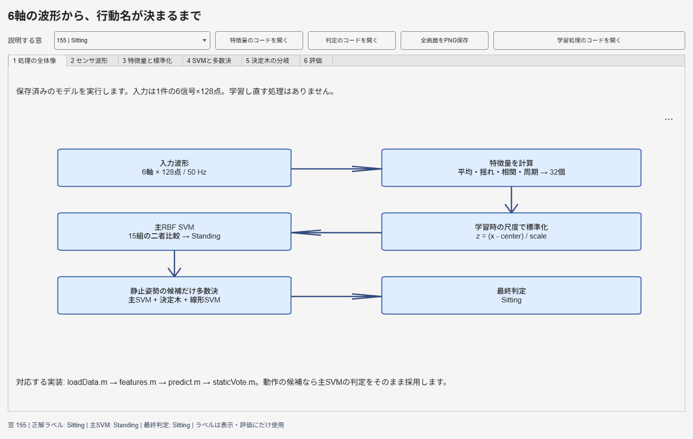
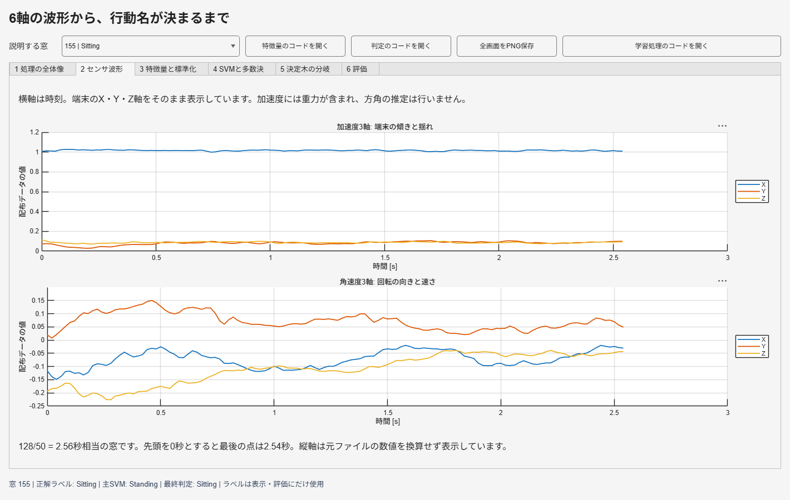
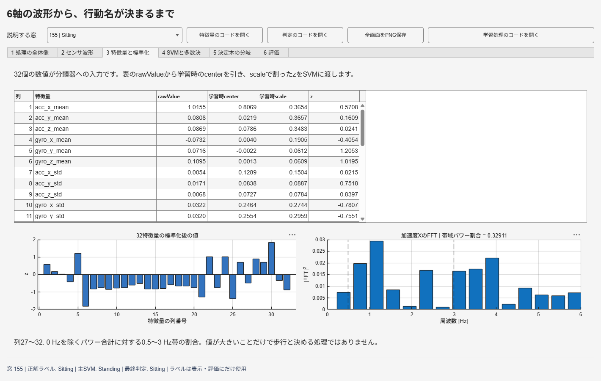
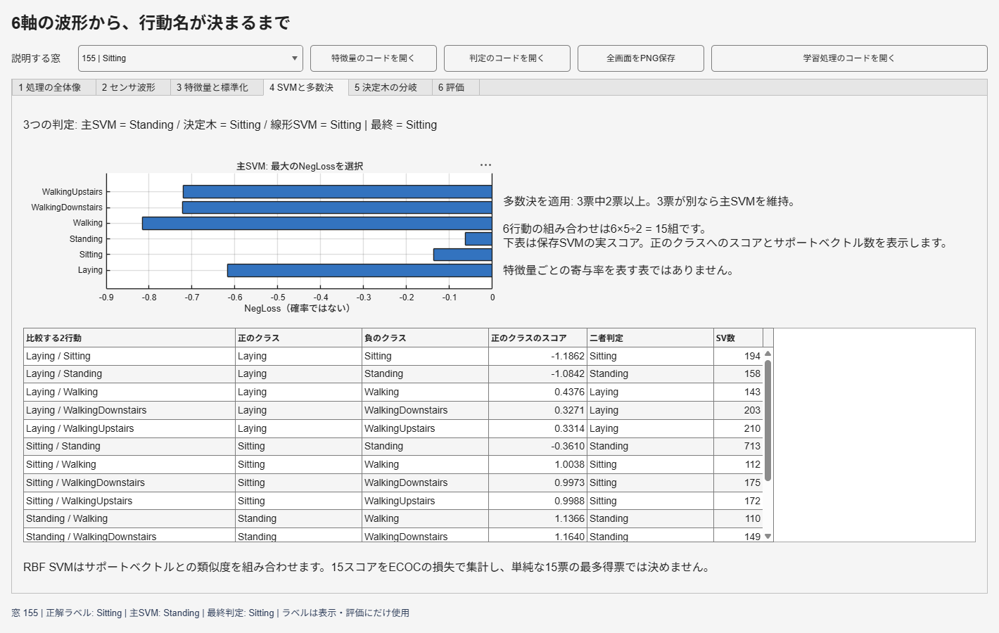
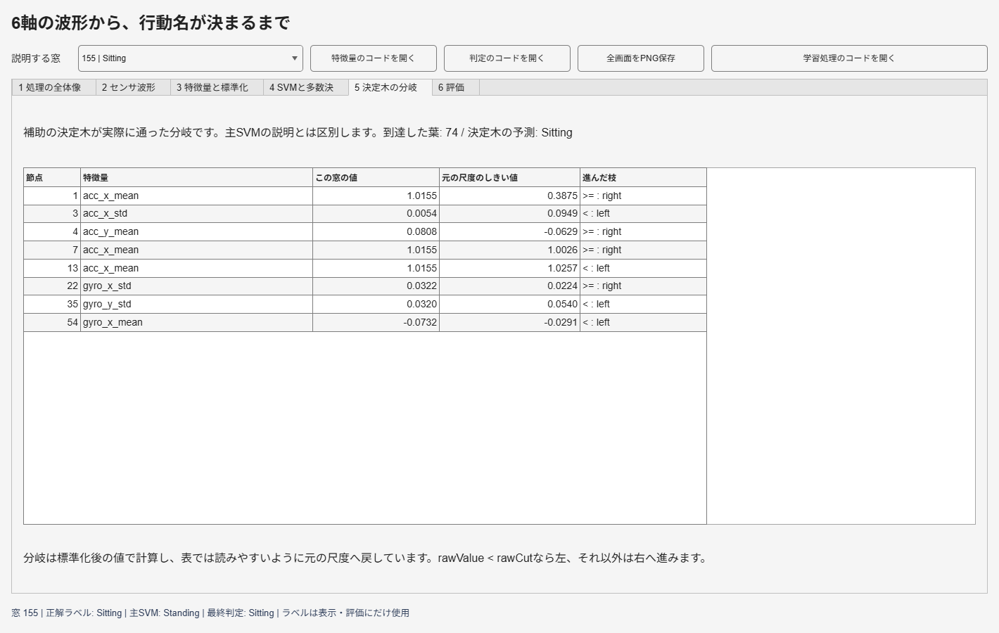
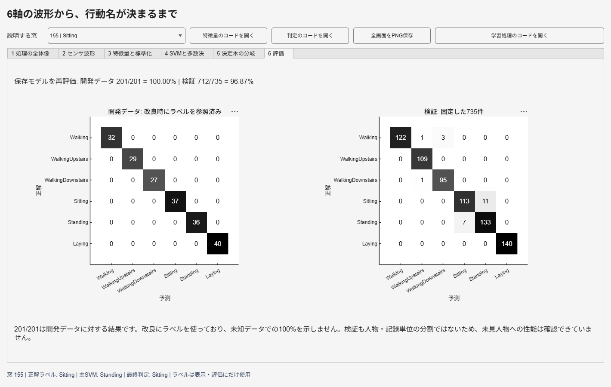
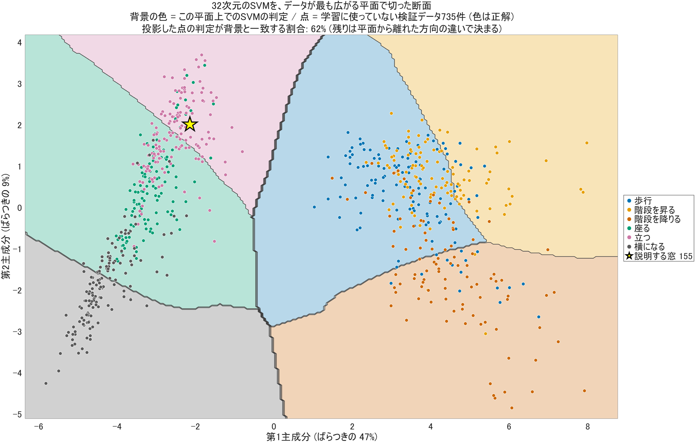
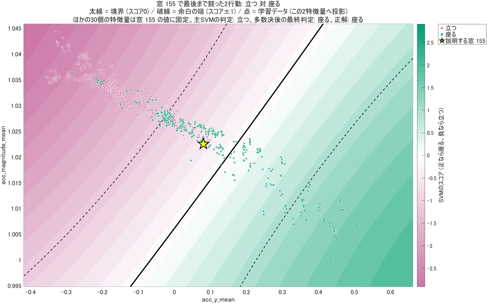
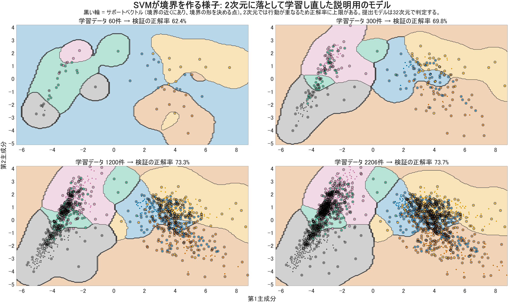

# MATLAB画面を使った行動認識の説明

学習済みの `proto_v10` に実データを入力し、波形が行動名へ変わる過程を説明するデモです。画面の数値は保存モデルから計算し、最終判定は既存の `har.predict` と照合しています。説明用に別の分類器を学習する処理はありません。

分類学習器の画面で単一SVMを作り、テストデータで評価する手順は [classification_learner.md](classification_learner.md) にあります。

## 起動

MATLABの「現在のフォルダー」をこのリポジトリにして、次を実行します。

```matlab
run('presentation/demo_walkthrough.m')
```

[demo_walkthrough.m](demo_walkthrough.m) をエディターで開き、`%%` で区切ったセクションを上から実行しても構いません。波形 `demoRaw`、特徴量 `demoX`、標準化後の `demoZ`、主SVMの `demoNegLoss` がワークスペースに残るので、変数を開きながら説明できます。

図だけを開く場合は、次の2行です。

```matlab
addpath('matlab');
demoApp = har.demo;
```

最初は155件目の座位を表示します。上部の「説明する窓」で1〜201件を切り替えられます。番号は表示対象の選択にだけ使い、分類器の入力には含めません。画面上の正解ラベルも分類器には渡しません。

## 発表の進め方

6つのタブを左から順に見せる構成です。5〜8分で説明する場合の目安を示します。

| 画面 | 時間の目安 | 見せるもの | 説明する内容 |
|---|---|---|---|
| 1 処理の全体像 | 45秒 | 波形から最終判定までの処理図 | 128点×6軸を32個の特徴量に変換し、標準化してSVMへ渡す |
| 2 センサ波形 | 45秒 | 加速度と角速度の実波形 | 50 Hz、約2.56秒の窓。軸は端末の向きであり、人の上下や東西南北と固定対応しない |
| 3 特徴量と標準化 | 90秒 | 32特徴量の表、zの棒グラフ、FFT | 平均・揺れ・相関・周期性を数値化する。学習時に保存した平均と尺度を使う |
| 4 SVMと多数決 | 90秒 | 6クラスのNegLoss、15組のSVM、3つの予測 | 主SVMの集計結果と、静止姿勢だけに使う多数決を区別する |
| 5 決定木の分岐 | 60秒 | 155件目が通った8つの分岐 | 補助の木が使った特徴量・値・しきい値をたどる |
| 6 評価 | 45秒 | 開発データと検証データの混同行列 | 201/201と712/735の対象を明示し、未知データでの性能と区別する |

画面上部のボタンから、特徴量・判定・学習の実装をMATLABエディターで開けます。表に収まらない行はスクロールして見せてください。「全画面をPNG保存」は6タブの画像と特徴量・SVM・木のCSVを `artifacts/demo/` に出力します。

## 1．入力から判定までの対応



「1件の入力は、加速度3軸と角速度3軸を128点ずつ記録した波形です。波形をそのままSVMへ入れる代わりに、動きを表す32個の数値にまとめています。SVMが静止姿勢を予測した場合だけ、補助2モデルとの多数決を使います」と説明します。

| 処理 | 実装 | 入力と出力 |
|---|---|---|
| データの読み込み | [loadData.m](../matlab/+har/loadData.m) | 共通の `data/prestudy` から `N×128×6` の配列を作る |
| 特徴量の計算 | [features.m](../matlab/+har/features.m) の `spectral32` | 1件ごとに32個の数値を計算する |
| 標準化と主SVM | [predict.m](../matlab/+har/predict.m) | 保存済みcenter・scaleで標準化し、主SVMを実行する |
| 静止候補の多数決 | [staticVote.m](../matlab/+har/staticVote.m) | 主SVM・決定木・線形SVMの3票を集計する |
| 説明用の値の取得 | [explainWindow.m](../matlab/+har/explainWindow.m) | 実スコア、実際の木の分岐を取り出し、既存の最終判定と一致を確かめる |
| 図と表の表示 | [demo.m](../matlab/+har/demo.m) | 同じ窓の波形・特徴量・判定経路を6画面に表示する |

## 2．波形と特徴量



155件目は正解ラベルが `Sitting` の窓です。加速度には重力が含まれます。角速度は回転の速さを表し、その値だけで絶対的な身体の向きが分かるわけではありません。縦軸は元のMATファイルの数値を換算せず表示しています。



32個の内訳は6軸の平均6個、標準偏差6個、合成加速度4個、合成角速度4個、軸間相関6個、帯域パワー割合6個です。右下のFFTは加速度Xを例に、0.5〜3 Hz付近の動きを表示します。実際の計算は0 Hzを除いた正の周波数64ビンを使い、この帯域に入る6ビンのパワー割合を求めます。

`features.m` は複数モデルで共用しているため、別の特徴量セットの処理も入っています。今回の `spectral32` は `shape32` の分岐には入りません。冒頭で各軸の平均・標準偏差を計算し、続いて合成値・FFT・相関を計算します。その後、`columns=[1:20,27:32]` で途中の「最大パワーの周波数」6個を外し、`case 'spectral32'` で帯域パワー割合6個を加える経路です。

発表では表の1行目を使うと、標準化の計算を具体的に示せます。

```text
155件目のacc_x_mean = 1.0154515117
学習時center         = 0.8068572146
学習時scale          = 0.3654205016
z = (1.0154515117 - 0.8068572146) / 0.3654205016
  ≈ 0.5708335909
```

「この窓の数値を、学習時の平均からどれだけ離れているかという尺度に変えています。今回入力した201件から平均を求め直すことはありません」と説明します。zの大きさを、その特徴量の重要度と読み替えないようにします。

## 3．SVMのスコアと多数決



主SVMは6行動を2行動ずつ比べる15個のSVMで構成されています。それぞれが保存済みのサポートベクトルと入力の類似度を使ってスコアを計算し、MATLABがECOCの損失へ集計します。画面の `NegLoss` は損失の符号を反転した値で、最大のクラスが主SVMの予測です。[MathWorksのpredict仕様](https://www.mathworks.com/help/stats/classificationecoc.predict.html)

155件目の主SVMは `Standing` です。しかし補助の決定木と線形SVMは両方とも `Sitting` を出し、3票中2票で最終判定が `Sitting` に変わります。

```text
主RBF SVM  : Standing
決定木     : Sitting
線形SVM    : Sitting
最終判定   : Sitting
```

主SVMが `Walking`・`WalkingUpstairs`・`WalkingDownstairs` を予測した場合は、多数決による変更をしません。主SVMが静止姿勢を予測しても3票がすべて異なれば、主SVMの予測を維持します。補助モデルが動作クラスに2票を出せば、そのクラスが採用されるのが現行実装です。

「SVMのスコアは正解確率ではありません。下表の二者判定を単純に15票として数える処理でもありません」と補足します。主RBF SVMには、全入力に共通する単一のしきい値表や特徴量別の寄与率はありません。

## 4．決定木がたどった条件



この画面は補助の決定木の説明です。主RBF SVMそのものの判定理由とは区別します。

例えば最初の2条件は、`acc_x_mean = 1.01545` が `0.38746` 以上なので右へ、続いて `acc_x_std = 0.00535` が `0.09486` 未満なので左へ進みます。その後の分岐も通って座位の葉へ到達します。表には選んだ窓が実際に通った条件だけを順番に並べています。

木は標準化後の値で分岐しますが、画面ではしきい値を元の特徴量の尺度に戻しています。丸め表示で境界が同じに見える場合は、保存したCSVで桁数を確認できます。

## 5．学習時の処理

「学習処理のコードを開く」で [train.m](../matlab/+har/train.m) を開きます。ここはモデルを作ったときの処理で、デモの推論時には実行しません。

1. [protocol.m](../matlab/+har/protocol.m) の固定分割で、学習2,206件と検証735件を分けます。
2. [augment.m](../matlab/+har/augment.m) で学習窓から振幅0.8倍・1倍・1.2倍のデータを作り、主SVM用の観測を6,618件にします。加速度の各軸平均は維持します。
3. 特徴量32個を計算し、学習データからcenter・scaleを求めます。
4. `templateSVM` と `fitcecoc` で、Gaussianカーネル、`KernelScale=4`、`BoxConstraint=1`、`onevsone` の主SVMを学習します。
5. 既存の `proto_v1` の木と `proto_v2` の線形SVMを補助モデルとして組み込みます。補助モデルは元の2,206件で学習しており、それぞれのcenter・scaleを持ちます。
6. `bundle` を `trained.mat` に保存します。予測時はこのファイルを読み込み、入力の特徴量を保存済みの尺度で変換します。

正解ラベルを使うのは学習と評価です。推論関数 `har.predict(bundle, raw)` の引数はモデルとセンサ波形だけです。

## 6．結果と限界



モデルを再評価した結果は、開発データ201/201件、検証712/735件です。混同行列は縦が正解、横が予測で、対角線が正しく分類した件数です。

「開発データは、以前の誤分類を調べて改良するときに正解ラベルを参照しています。そのため100%は未知データでの性能を証明する値ではありません。検証分割も人物・記録単位ではなく、未見人物への性能は別に確認が必要です」と説明します。

窓の特徴量を取り出す処理や、SVM・木の出力は再現できます。ただし、センサ波形から現実の身体動作の原因を一意に断定したり、RBF SVMの判断を一つの特徴量だけで説明したりするものではありません。詳細な数式と特徴群の実測感度は、[分類基準のレポート](../reports/classification-criteria-ja.md)を参照してください。

## 7．SVMの判定を2次元の図で見る

`har.decisionMap(pwd, 155)` を実行すると、3つの図が開きます。`demo_walkthrough.m` ではセクション5です。

| 図 | 何を示すか | 使っているモデル |
|---|---|---|
|  | 32次元のSVMを、データが最も広がる平面で切った断面。背景の色がSVMの判定、点が検証データ | 保存済みの主SVM |
|  | 選んだ窓で最後まで競った2行動の境界（太線）と余白の端（破線）。ほかの30個の特徴量は窓の値に固定 | 保存済みの主SVMのうち1組 |
|  | 学習データを増やすと境界が整う様子。黒い輪がサポートベクトル | 説明用に2次元で学習し直したモデル |

1枚目は断面なので、点を投影すると背景の色と食い違うことがあります。一致する割合は図の上部に表示されます。3枚目は説明用のモデルで、提出するモデルの正解率を示す図ではありません。

スライドは [行動認識モデル 発表スライド](https://claude.ai/artifact/RKMZRtd61dsU9AHmRYxQb2) にあります。結果の検証と数字の読み方は [レビュー](../reports/review-ja.md) にまとめています。

## 動作確認

MATLABで次を実行すると、201件の判定一致、15個のSVMのスコア取得、補助木の分岐と葉の一致、窓の切り替え、6枚の画像保存を確認できます。

```matlab
run('tests/check_explanation.m')
```

この手順書の画像はMATLABの実行画面を `exportapp` で保存したものです。UI部品を含む画面全体の保存には、MATLABの[exportapp](https://www.mathworks.com/help/matlab/ref/exportapp.html)を使っています。画像と同じフォルダの [snapshot.json](images/row155_snapshot.json) に、元モデル・データのハッシュと表示対象の判定を記録しています。
