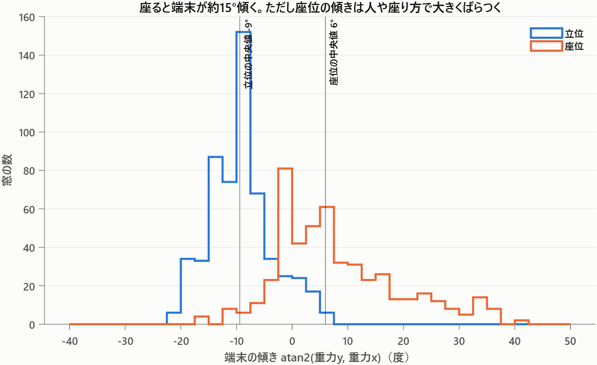
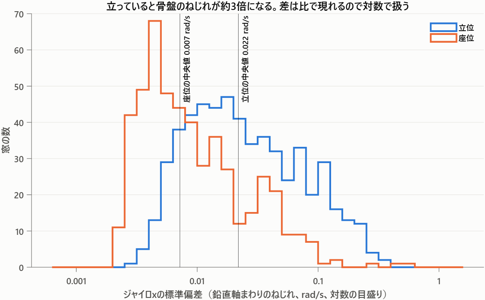

# 特徴量とモデルの検証：何が必須で、何列あれば足り、なぜ必要か

2026年11月15日に行った検証の報告です。セミナー資料（2026/11/12「Matlabデータサイエンスコンテストの予習」）にある8人の工夫を出発点に、特徴量とモデルを比べました。そのうえで、本番提出の候補を1つに決めています。

## 結論

- **必須なのは「姿勢（重力の向き）」です**。姿勢を表す列をすべて抜くと、正解率は96.8%から86.6%に落ちます。座位と立位の取り違えは83件から170件に、臥位と座位は1件から119件に増えます。3種類のモデルすべてで同じ結果でした。
- **次に効くのは「動きの強さ」「着地の衝撃」「体の揺れ（ジャイロ）」です**。特にジャイロは、立位で大きくなる骨盤のねじれを通じて座位と立位を分けるのに役立ちます。
- **躍度（加加速度）では座位と立位を分けられません**。静止中の躍度はセンサの雑音と同じ大きさで、横たわって静止している窓とも差がありません。効いたのは鉛直軸まわりのねじれ（ジャイロx）で、対数で扱うと座位↔立位の誤りが減りました（第5節）。
- **不要なものもあります**。ジャイロの平均（3列）は、どの行動の組でも分離度がほぼ0でした。抜くと逆に精度が上がります。「Z方向の変化量」は、この端末ではZ軸が上下方向ではないため、階段の上り下りを分けられません。
- **最小構成は5列です**。5列で95%に届き、10〜14列でほぼ頭打ちになります。主催者の12列（各軸の平均と標準偏差）は、最良のモデルでも93.2%でした。
- **本番候補は「人体工学の役割で選んだ30列（＋ゼロ2列）＋ガウスSVM＋学習データの拡張」です**。回転の揺れ3列は対数で持ち、学習データで求めた固定の定数で全クラスまとめて1回だけ標準化します。記録単位の交差検証で98.18%（5回の標準偏差0.08ポイント、最悪98.06%）、テスト201窓で198件正解でした。装着角度20°のずれを加えても約95%を保ちます。
- **本番で100%は保証できません**。残る誤りのほとんどは座位と立位の取り違えです。腰の端末は脚の曲がりを測れないため、背筋を伸ばして座った姿勢と、少し前かがみで立った姿勢を区別できません。これはモデルではなくセンサの位置による限界です（後述）。

数値はすべて、学習用2941窓の記録単位の交差検証で測りました。テスト201窓は特徴量・モデル・設定のどの選択にも使っていません。

## 1. セミナーの実証内容の整理

| 人 | 手法 | 特徴量の工夫 | 報告された分類率 |
|---|---|---|---|
| 平野 | k-NN | 重要度の低いジャイロ平均3列を外し9列 | 96.4% |
| 梶山 | 部分空間k-NN | 加速度の標準偏差を外し、最大・最小を追加 | 97.2% |
| 阿部ナオ | 部分空間k-NN | — | 95.7% |
| 阿部有希 | 部分空間k-NN | 12列→10列 | 97.0% |
| 石井 | バギング木 | 平均・標準偏差・重力の向き・加速度の変化率 | 96.8% |
| 松井 | k-NN | 最大・最小・二乗平均平方根、Z軸の変化量（30列） | 94.8% |
| 野原 | ガウスSVM | 大きさの統計・軸の相関・重力の向き・変化率、0.8/1.2倍の拡張 | 99.4% |
| 新井 | — | 最大・最小・大きさ・Z方向の変化量・XY方向の動き・差分（32列） | 99.9% |

報告された分類率は分類学習器の「検証」の値と考えられます。配布データの窓は隣の窓と64点ずつ重なっています。無作為に分けると同じ記録の隣の窓が学習側と検証側に入るので、数字が高めに出ます。この報告では、64点を共有する窓を1つの記録にまとめ、記録ごとに分ける交差検証で測り直しました。各人の案をすべて計算できるように71列の候補（`scripts/feature_study/featurePool.m`）を作り、そこから各人の組み合わせを近似して再現しています。

| 特徴量セット（近似） | 列数 | 最良の手法 | 記録単位の交差検証 | 同じ列でのガウスSVM |
|---|---|---|---|---|
| 主催者の12列 | 12 | バギング木 | 93.2% | 90.9% |
| 平野案（ジャイロ平均を外す） | 9 | 部分空間k-NN | 95.4% | 91.4% |
| 松井案 | 27 | ニューラルネット | 95.0% | 93.5% |
| 新井案 | 30 | ニューラルネット | 95.9% | 94.7% |
| 野原案 | 32 | ニューラルネット | 96.2% | 95.8% |
| 既存の spectral32 | 32 | ニューラルネット | 96.3% | 95.5% |
| 71列すべて | 71 | ニューラルネット | 96.8% | 96.7% |

どの案でも、誤りの大半は座位と立位の取り違えでした（ガウスSVMで70〜110件）。階段の上りと下りの取り違えは衝撃や揺れの列を足すと10件以下に減ります。詳細は `evaluation/feature_study/stage1_set_by_method.csv` にあります。

## 2. 何が必須か

### 列を1系統ずつ抜いても、ほとんど下がらない

71列から1系統（例：「加速度の平均」）ずつ抜くと、低下は最大でも0.5ポイントでした。重力の向きは「加速度の平均」「重力の向き」「最大・最小」「二乗平均平方根」の4系統に重複して入っています。そのため、1系統を抜いてもほかの系統が代わりを務めます。

### 意味のまとまりごとに抜くと、姿勢だけが決定的に効く

同じ情報を持つ列をまとめて抜きました（`stage2c_concept_ablation.csv`）。

| 抜いたもの | 残る列 | ガウスSVM | 座位↔立位の誤り | 臥位↔座位の誤り |
|---|---|---|---|---|
| なし | 71 | 96.8% | 83 | 1 |
| 姿勢（窓の平均＝重力を含む列） | 54 | 86.6% | 170 | 119 |
| ジャイロのすべて | 46 | 95.3% | 124 | 0 |
| 軸どうしの相関 | 64 | 96.0% | 102 | 1 |
| 動きの強さ | 37 | 96.2% | 98 | 1 |
| リズム（周波数） | 63 | 96.5% | 87 | 1 |
| 衝撃（躍度・差分） | 60 | 96.8% | 83 | 1 |

k-NN とバギング木でも、姿勢を抜いたときだけ大きく下がりました（k-NN 94.0%→82.6%、バギング木 96.6%→90.8%）。衝撃やリズムを抜いても下がらないのは、強さの列が同じ情報を一部持っているからです。そこで、少ない列から足していく実験でも確かめました（次節）。

### 不要な列

| 列 | 理由 |
|---|---|
| ジャイロの平均（x/y/z） | どの組でも分離度（フィッシャー比）が0.11以下。行動に関係なく、ほぼ0の周りのセンサのずれを測っている。外すとガウスSVMで90.9%→91.4%、k-NNで87.1%→93.8% |
| 加速度のZ軸の変化量 | この端末の上下方向はx軸。Z軸の振れ幅は上り/下りの分離度0.17で、x軸の最大値（2.41）の14分の1 |
| 二乗平均平方根・最大・最小（姿勢として） | 平均と重複する。姿勢の情報は重力の向き3列で足りる |
| 歩調（卓越周波数） | 上り/下りの分離度0.34。0.5〜3 Hz の帯域の割合のほうが安定して効く |

k-NN は、関係の薄い列が入ると精度が落ちます。71列すべてを入れたk-NNは94.0%で、14列に絞ると97.5%でした。セミナーで k-NN を使った人は、列を減らしたほうが良くなっています。これは偶然ではありません。

## 3. 最小で何列あれば足りるか

1列ずつ、交差検証の正解率がいちばん上がる列を足しました（前向き選択）。3つの手法で別々に行っています。


| 列数 | ガウスSVM | k-NN | バギング木 |
|---|---|---|---|
| 1 | 69.7% | 64.3% | 63.6% |
| 2 | 84.0% | 83.6% | 83.7% |
| 3 | 88.6% | 91.6% | 90.7% |
| 5 | 93.7% | 95.1% | 95.1% |
| 10 | 96.1% | 96.9% | 96.1% |
| 14 | 96.3% | 97.5% | 96.3% |

最初に選ばれる列は3つの手法でほぼ共通でした。

1. x軸（鉛直方向）の最大加速度：静止か動作か、階段下りの衝撃、臥位（x軸に重力がかからない）
2. 重力の向きのy成分：体幹の傾き（座位か立位か）
3. 重力の向きのz成分、または加速度の変化率：傾きの残りの成分、着地の衝撃
4. 加速度の変化率・2階差分：着地の衝撃
5. 水平面（xy）の揺れの大きさ：歩行と階段の違い

この5列（鉛直の最大加速度、傾き2成分、衝撃、水平の揺れ）で95%に届きます。これが最小構成です。10〜14列で頭打ちになり、それ以上足しても0.5ポイントも伸びません。

## 4. 人体工学的な意味と、必要であることの根拠

この端末（UCI HAR と同じ、腰に装着したスマートフォン）では、**x軸が鉛直方向**です。立位・歩行ではx軸の平均がほぼ1 g、臥位ではほぼ0 gになります（下表）。

| 行動 | x軸の平均 | y軸の平均 | z軸の平均 | ジャイロxの標準偏差 |
|---|---|---|---|---|
| 歩行 | 0.995 g | −0.183 | −0.070 | 0.476 |
| 階段上り | 0.955 g | −0.266 | −0.141 | 0.468 |
| 階段下り | 0.990 g | −0.150 | −0.059 | 0.592 |
| 座位 | 0.956 g | 0.138 | 0.138 | 0.018 |
| 立位 | 1.001 g | −0.162 | −0.035 | 0.045 |
| 臥位 | 0.076 g | 0.633 | 0.547 | 0.029 |

それぞれの役割について、生体動作としての理由と、データで確かめた根拠を並べます。

### 姿勢：重力の向き（必須）

- 生体動作の面では、椅子に座ると骨盤が後ろに傾き、腰に付けた端末も傾きます。臥位では体幹が水平になり、重力が端末のy・z方向にかかります。
- データでは、端末の傾き（重力のy成分とx成分の角度）の中央値は、立位が−9°、座位が+6°でした。座ると約15°傾きます。臥位は重力のx成分が0.08で、ほかの行動（0.93〜0.97）と重なりません。
- 必要である根拠として、姿勢の列をすべて抜くと、座位↔立位の誤りが2倍、臥位↔座位の誤りが1件から119件に増えます。静止している3つの行動は動きの量がほぼ同じです（加速度の標準偏差0.005前後）。動きの列だけでは区別できず、ほかの列では代わりになりません。



### 体の揺れ：ジャイロ（座位と立位の補助）

- 生体動作の面では、立っている人は、左右の脚に体重を移しかえるたびに骨盤が鉛直軸まわりにねじれます。座っている人は坐骨と太ももが座面に接するので、このねじれが抑えられます。
- データでは、ジャイロx（鉛直軸まわり）の標準偏差の中央値は、立位0.022 rad/s、座位0.007 rad/sで、約3倍の差がありました。前後・左右の傾きの揺れ（ジャイロy・z）には差がありません（第5節）。
- 必要である根拠として、ジャイロの列をすべて抜くと、座位↔立位の誤りが83件から124件に増えます。k-NN 14列から gyro_std_x の1列だけを抜いても、44件から60件に増えました。

### 動きの強さ（静止と動作を分ける）

- 生体動作の面では、歩くと、1歩ごとに体の重心が上下・左右に動きます。静止時には呼吸程度の動きしかありません。
- データでは、水平方向の揺れの平均は、静止と動作の分離度が21.6で、全71列で最大でした。加速度の標準偏差は、歩行0.23 gに対し静止は0.005 gです。
- 必要である根拠として、前向き選択では、どの手法でも1列目（鉛直の最大加速度）がこの役割を担いました。この1列だけで静止と動作がほぼ分かれます。

### 着地の衝撃：躍度（階段の上りと下りを分ける）

- 生体動作の面では、階段を下りるときは、体を下の段へ落としながら脚で受け止めます（筋が伸ばされながら力を出す、遠心性収縮）。着地の衝撃は上りや平地歩行より大きくなります。
- データでは、x軸の最大加速度は下り1.92 g、上り1.60 g、歩行1.56 gでした。上下方向の躍度の最大値は下り24.8 g/s、上り13.8 g/s です。上り/下りの分離度は、x軸の最大値が2.41、上下の躍度が1.72でした。
- 必要である根拠として、前向き選択で3〜4列目にこの列が入ると、階段の上り↔下りの誤りが77件から40件以下に減ります（ガウスSVM）。

### リズムと協調：歩調と体の回旋（歩行と上り階段を分ける）

- 生体動作の面では、階段を上るときは1段ずつ体を持ち上げるので、歩調が遅くなります。体幹の前傾も大きくなります。歩行では、骨盤の回旋と左右の傾きが一定の関係で連動します。
- データでは、加速度の大きさの卓越周波数は、歩行1.75 Hz、上り1.60 Hz、下り1.80 Hz でした。歩行と上りを最もよく分けるのは、y軸の0.5〜3 Hz の割合（分離度1.65）と、加速度のxとyの相関（0.87）です。上りでは重力のy成分が−0.27で、ほかの歩行（−0.15〜−0.18）より前傾しています。
- 必要である根拠として、協調の列をすべて抜くと、歩行↔下りの誤りが2件から7件に、座位↔立位の誤りが83件から102件に増えます（ガウスSVM）。

### この「根拠」の範囲

ここでの「必要である」は配布データでの除去実験と分離度に基づく経験的な根拠です。数学的な証明ではありません。人物IDがないため、同じ人の別の記録が学習側と検証側に分かれている可能性も残ります。

## 5. 躍度で座位と立位を分けられるか（追加の検証）

躍度（加加速度：加速度の時間変化率）で座位と立位を分けられるかを、座位と立位の2クラスだけで調べました（`scripts/feature_study/stage5_sitstand_loop.m`）。静止中の動きは歩行の100分の1程度しかないので、生の値に加えて対数も試しています。候補は42列（`staticPool.m`）です。躍度、スナップ（加速度の2階の変化率）、角加速度（ジャイロの変化率）、揺れの帯域ごとの強さ、傾き角の揺れを含みます。重力の向き3列を出発点に、候補を足して記録単位の交差検証で測る作業を繰り返しました。

| 候補 | 座位と立位の分離度 |
|---|---|
| 重力の向きのy成分（傾き） | 2.07 |
| ジャイロxの0.3〜2 Hz の揺れ（対数） | 0.52 |
| ジャイロxの標準偏差（対数） | 0.47 |
| ジャイロxの標準偏差（生の値） | 0.17 |
| ジャイロxの角加速度（対数） | 0.29 |
| 加速度の躍度 y（対数） | 0.05 |
| 加速度の躍度 x・z（対数） | 0.006・0.003 |
| 加速度のスナップ（対数） | 0.04以下 |

**加速度の躍度では分けられません。** 理由はセンサの雑音です。静止中の躍度の中央値（x/y/z、g/s）は、臥位0.128/0.116/0.174、座位0.108/0.121/0.181、立位0.113/0.147/0.180でした。ベッドに横たわって静止している窓と、座位・立位の窓が、ほぼ同じ値です。躍度は隣り合う点の差を取るので、50 Hz の細かい雑音が強められます。静止中の躍度は、体の動きではなく、この雑音の大きさを測っていると考えられます。

**効いたのはジャイロxの揺れ（対数）です。** 前向き選択（ガウスSVM）では、重力の向き3列の88.6%に、ジャイロxの標準偏差（対数）、ジャイロzの角加速度（対数）、ジャイロyの標準偏差（対数）、左右の傾き角の順に列が入り、94.6%になりました。加速度の躍度は1列も選ばれていません。k-NN では重力の向きと加速度の大きさで95.1%です。どの手法でも、2クラスの上限は95%前後のままでした。

人体工学の面では、次のように解釈できます。

- 立位では、左右の脚に体重を移しかえるたびに骨盤が鉛直軸まわりにねじれます。座位では坐骨と太ももが座面に接するので、このねじれが抑えられます。中央値は立位0.022 rad/s、座位0.007 rad/sで、約3倍でした。
- 前後・左右に傾く揺れ（ジャイロy・z）は、座位と立位で同じでした。標準偏差の平均は、yが座位0.028・立位0.029、zが座位0.022・立位0.022 rad/s です。足首を支点に体が前後に揺れる「倒立振子」の動きは、腰の端末では差になっていません。
- 差は「比」で現れます。歩行のねじれ（約0.5 rad/s）と同じ目盛りに並べると、0.007と0.022の差は標準化でほぼ消えます。対数にすると比が差になり、モデルが使えるようになります。



6クラスの本番候補に入れて比べました（`stage5b_six_class.m`、3回くり返し。拡張とずれの評価は第4段と同じ）。

| 変更 | 列数 | ずれなし | 角度20° | J | 座位↔立位の誤り |
|---|---|---|---|---|---|
| 変更前（人体工学30列） | 30 | 97.05% | 93.3% | 96.42% | 76 |
| 加速度の躍度（対数）2列を追加 | 32 | 97.03% | 93.3% | 96.41% | 77 |
| ジャイロの標準偏差を対数に置き換え | 30 | 98.04% | 94.9% | 97.50% | 47 |
| さらに角加速度（対数）2列を追加 | 32 | 98.03% | 95.1% | 97.50% | 49 |

角加速度を足しても変わらないので、最も単純な「ジャイロの標準偏差3列を対数にする」だけを本番に採用しました。この表の交差検証は、比較用に全クラスをまとめて標準化した値です。分類学習器の既定の「2クラスの組ごとの標準化」で本番モデルを学習し直すと、97.22%から97.59%になりました。この差は標準化の方式によるもので、第6節で詰めています。

躍度に人体工学的な意味がないわけではありません。階段を下りるときの着地の衝撃は躍度に強く現れ、本番の30列でも上りと下りを分けるために5列使っています（第4節）。躍度が役立つのは動いているときの衝撃で、静止中の姿勢の違いではない、というのがこの検証の結論です。

## 6. 本番と同じ学習方法での比較（標準化・設定・手法）

第5節の比較では、全クラスをまとめて1回だけ標準化していました。分類学習器の既定は、2クラスの組ごとの標準化です。そこで本番と同じ学習方法（`fitcecoc` と `templateSVM`）で、標準化の方式・空いている2列の使い道・設定・手法を順に比べました（`stage6_production_loop.m`、`stage6b_methods.m`、3回くり返し）。

**標準化は全クラスで1回にします。** どの列の組でも、全クラスで1回のほうが良い結果でした。

| 標準化の方式 | ずれなし | J | 座位↔立位の誤り |
|---|---|---|---|
| 2クラスの組ごと（分類学習器の既定） | 97.52% | 0.9706 | 63 |
| 全クラスで1回 | 98.04% | 0.9750 | 47 |

組ごとに標準化すると、座位と立位の組では、静止中の値の小さな差が組の中のばらつきで割られます。全クラスで1回にすると、歩行まで含めた目盛りの上で、静止時の差がそのまま残ります。本番では、学習データ（2941窓＋拡張8通り）で求めた30列の平均と標準偏差を、前処理関数に定数として書き込みます（`write_scaling.m`）。どの試行も同じ定数で割るので、その試行の128点だけから計算するという規則は守られます。分類学習器では「データを標準化」を切って学習します。

**空いている2列は使いません。** 傾きの角度、加速度の平均の大きさ、揺れの帯域などを2列足しても、Jの差は0.0005以内で誤差の範囲でした。

**設定は平坦な範囲の中央を選びました。** カーネルスケール1.0〜2.0×√30、ボックス制約3〜30では、Jが0.973〜0.977、ずれなしが97.8〜98.3%に収まります。調べた範囲の端にある最良の点（1.0×√30、ボックス制約3）は避け、中央の1.4×√30（7.7）、ボックス制約10にしました。

**手法はガウスSVMが最良でした。** 30列・拡張・ずれの評価をそろえて、手法だけを変えています。

| 手法 | ずれなし | 角度20° | J | 座位↔立位の誤り |
|---|---|---|---|---|
| ガウスSVM | 98.16% | 94.6% | 0.9747 | 43 |
| ニューラルネット | 97.77% | 93.9% | 0.9716 | 50 |
| 線形SVM | 96.82% | 93.3% | 0.9617 | 66 |
| バギング木 | 97.42% | 91.9% | 0.9577 | 58 |
| 部分空間k-NN | 96.46% | 92.5% | 0.9556 | 93 |
| k-NN | 93.34% | 89.8% | 0.9228 | 177 |

ここで比較のループを止めました。座位↔立位の誤り43件は、座位と立位の窓1057件に対して95.9%の正解にあたり、2クラスだけで調べた上限（約95%）に届いています。最後の周回の差も誤差の範囲でした。

## 7. 精度の不安定さをなくすためにしたこと

これまでの単一SVM（gravity32）は、テスト201窓で201件になる設定が858通り中1通りしかなく、近い設定では200件でした。設定を少し変えると結果が変わる状態です。今回は次の4つで不安定さを減らしました。

1. 評価の水増しを除きました。 記録単位の交差検証を5回くり返し、平均・標準偏差・最悪の回を見ました。テスト201窓は選択に使っていません。
2. ずれに強い列と学習を選びました。 評価側の窓にだけ、本番で起こりうるずれを加えて測りました。具体的には、装着角度10°・20°、動きの強さ0.7倍・1.3倍、歩調0.85倍・1.15倍、センサ雑音です。学習側には強さ0.8/1.2倍、角度10°、歩調0.9/1.1倍、雑音の拡張を加えました。
3. 平坦な場所の設定を選びました。 カーネルスケールとボックス制約を5×5で調べました。カーネルスケール1.0〜2.0×√p、ボックス制約10〜100の範囲では、正解率が0.3ポイント以内に収まります。この範囲の中心付近を選んでいます。
4. 学習の乱数を変えても判定が変わらないことを確かめました。 拡張の乱数を3通りに変えて学習し直すと、テスト201窓の判定は99.5〜100%一致しました。

### 候補の比較

目的関数Jは「ずれなし」と「現実的なずれ5種」の正解率の平均です（`stage4_sets.csv`、3回くり返し）。

| 候補 | 列数 | ずれなし | 角度20° | 雑音 | J |
|---|---|---|---|---|---|
| 人体工学30列＋SVM＋拡張（雑音込み） | 30 | 97.1% | 93.3% | 96.8% | 96.4% |
| 人体工学30列＋SVM＋拡張（雑音なし） | 30 | 96.9% | 93.3% | 90.9% | 96.2% |
| 前向き選択20列＋SVM＋拡張 | 20 | 97.1% | 87.3% | 93.7% | 96.0% |
| spectral32＋SVM＋拡張（従来の延長） | 32 | 96.3% | 93.2% | 95.5% | 95.6% |
| k-NN 14列＋拡張 | 14 | 97.7% | 83.2% | 95.4% | 95.3% |
| spectral32＋SVM、拡張なし（従来） | 32 | 95.7% | 89.2% | 95.9% | 94.1% |

k-NN 14列はずれなしでは最も高い値でした。ただし、装着角度が変わると大きく下がります。k-NN は「よく似た窓が学習データにあるか」で判定するので、同じ人の別の記録を覚えている効果が含まれると考えられます。本番は別の人の別の記録なので、ずれに強いガウスSVMを選びました。

## 8. 本番候補のモデル

| 項目 | 内容 |
|---|---|
| 前処理関数 | `submission/ergonomic32_svm/Pretreatment_MATLABcontest_Advanced.m`（30列＋ゼロ2列＝32列） |
| 手法 | ガウスSVM、1対1。標準化は前処理関数の固定の定数で行い、分類学習器の「データを標準化」は切る |
| ハイパーパラメータ | カーネルスケール 7.7、ボックス制約 10 |
| 学習データ | 学習用2941窓＋拡張8通り＝26469行 |
| 記録単位の交差検証（5回） | 98.18%（標準偏差0.08ポイント、最悪98.06%） |
| テスト201窓 | 198件正解（98.5%）。誤りは下り→歩行2件、座位→立位1件。選択には使っていない |
| 保存先 | `model/final_ergonomic32_svm/trained.mat` と `model-info.json` |

30列の内訳は前処理関数のコメントに役割ごとに書いてあります。

| 役割 | 列 | 列数 |
|---|---|---|
| 姿勢 | 重力の向き x/y/z、加速度の大きさの平均 | 4 |
| 動きの強さ | 加速度の標準偏差 x/y/z、大きさの標準偏差、上下・水平の揺れ、xy の揺れ、x軸の最大値、ジャイロの標準偏差 x/y/z（対数）、ジャイロの大きさの平均 | 13 |
| 衝撃 | 加速度の変化率 x/y/z、上下方向の躍度の最大・最小 | 5 |
| リズム | 0.5〜3 Hz の割合（加速度x・y、ジャイロx）、歩調 | 4 |
| 協調 | 加速度xとyの相関、ジャイロyとz・zとxの相関、上下動の歪度 | 4 |

交差検証の混同行列（5回の平均）では、誤り約54件のうち約43件が座位と立位の取り違えでした。対数にする前は約82件のうち約72件、対数にして組ごとに標準化したときは約71件のうち約61件です。歩行・上り・下りの間の誤りは合わせて約10件です。臥位の窓はすべて正解し、臥位と誤る窓もありませんでした。この交差検証の標準化の定数は全学習データから求めているので、検証側の窓の情報がわずかに入ります。分割ごとに定数を求め直した第6節の値（98.16%）とほぼ同じです。

検査 `tests/check_final_pretreatment.m` では次の4点を確かめました。出力が試行数×32の有限な実数行列になること。列が実験で使った値と一致すること（回転の揺れ3列は対数、どの列も学習データから計算し直した定数で標準化して比べる。相対誤差8.6×10⁻¹⁶）。1試行ずつ渡しても値が変わらないこと。値が変化しない入力でも有限の値を返すこと。ゼロ埋めの2列が判定に影響しないことも確認しています。

## 9. 本番で100%にできるか

できるとは言えません。理由は2つあります。

1つ目に、座位と立位は腰のセンサだけでは原理的に重なります。 座位と立位を分ける主な手がかりは、腰の傾きです。しかし傾きは人や座り方でばらつきます。立位の傾きの分布は狭い（四分位範囲−13°〜−6°）一方、座位は広い（−0.5°〜+15°）範囲に広がります。背筋を伸ばして座った人の傾きは、立っている人とほぼ同じです。2つの姿勢の本当の違いは股関節と膝の曲がりですが、腰の端末にはそれが映りません。座位と立位だけを取り出して2クラスで分けても、最良のモデル（重力の向き＋k-NN）で95.4%でした。傾き1つのしきい値では89.5%です。躍度・揺れの帯域・ねじれなど静止中の微小な動きを42列足して探しても、95%前後から上がりませんでした（第5節）。

2つ目に、本番の審査データは別の人の記録と考えられます。 配布データには人物IDがありません。記録単位の交差検証でも、同じ人の別の記録が学習側に残っている可能性があります。そのため、知らない人に対する正解率は、ここでの98.2%より下がることもありえます。

本番で正解率を上げるために、次の2つを勧めます。

- 11/18に公開される本番データでも、同じ手順（`scripts/feature_study/` の第1〜4段）で記録単位の交差検証を行う。座位と立位の傾きの分布が配布データと同じかを確かめる。
- 本番データにテスト用の正解が付いていても、そのテストの正解数を見て設定を選ばない。選んだ設定は、未知のデータでは同じ精度が出ないためです。

## 再現方法

MATLAB R2026a で、リポジトリのフォルダから次の順に実行します。

```matlab
cd scripts/feature_study
root = fileparts(fileparts(pwd));
stage1_compare(root)                 % 特徴量セット×手法（約5分）
stage2_select(root, 'gauss_svm', 20) % 系統の除去と前向き選択（手法ごとに約10分）
stage2_select(root, 'knn', 16)
stage2_select(root, 'bagged_tree', 16)
stage2b_sitstand(root)               % 座位と立位だけの上限
stage2d_knn_tune(root)               % k-NN の設定
stage3_robust(root)                  % ずれへの強さ（候補は stage3_candidates.json）
stage4_final(root, 'sets')           % 最終候補の比較
stage4_final(root, 'grid')           % ハイパーパラメータの平坦さ
stage5_sitstand_loop(root)           % 座位と立位：躍度など静止中の微小な動き
stage5b_six_class(root, 'round1')    % 効いた列を6クラスで比較
stage5b_six_class(root, 'round2')    % 列の入れ替えと設定
stage6_production_loop(root, 'sets') % 本番と同じ学習方法：標準化の方式と空き2列
stage6_production_loop(root, 'grid', 'log30', 'global')  % 設定の平坦さ
stage6b_methods(root)                % 手法の比較
write_scaling(root)                  % 前処理関数に標準化の定数を書き込む
train_final(root)                    % 本番候補の学習と検証
make_figures(root)                   % 図
```

結果は `evaluation/feature_study/` に、本番候補のモデルは `model/final_ergonomic32_svm/` に出力されます。前処理関数の検査は `run('tests/check_final_pretreatment.m')` です。
