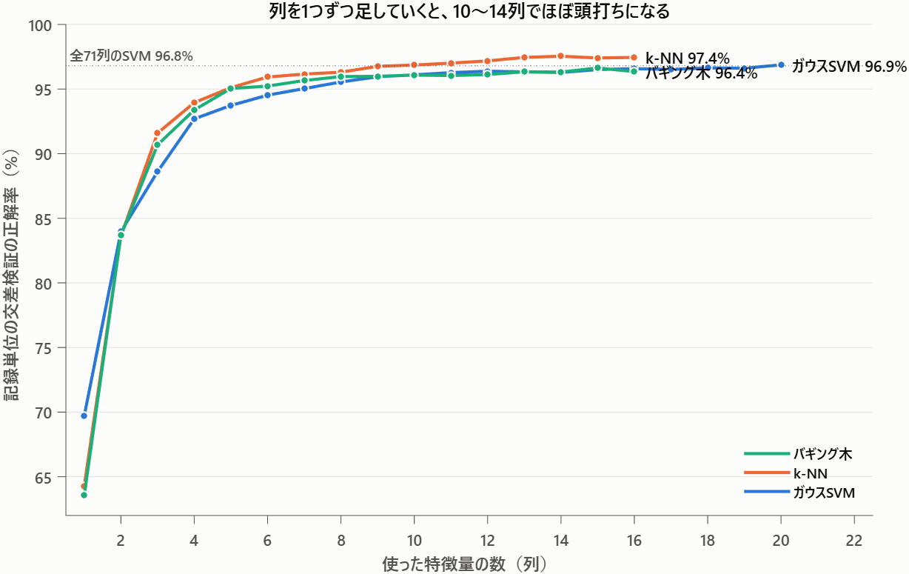
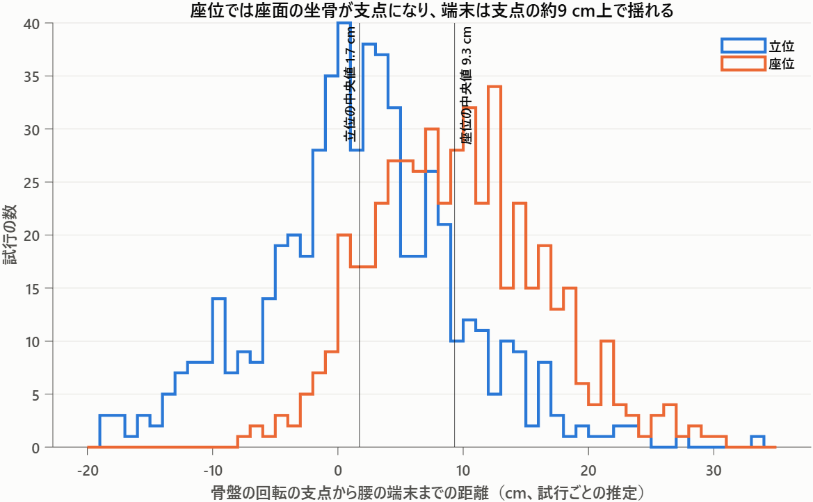

# 特徴量とモデルの検証：何が必須で、何列あれば足り、なぜ必要か

2026年11月15日に行った検証の報告です。セミナー資料（2026/11/12「Matlabデータサイエンスコンテストの予習」）にある8人の工夫を出発点に、特徴量とモデルを比べました。そのうえで、本番提出の候補を1つに決めています。

## 結論

- **必須なのは「姿勢（重力の向き）」です**。姿勢を表す列をすべて抜くと、正解率は96.8%から86.6%に落ちます。座位と立位の取り違えは83件から170件に、臥位と座位は1件から119件に増えます。3種類のモデルすべてで同じ結果でした。
- **次に効くのは「動きの強さ」「着地の衝撃」「体の揺れ（ジャイロ）」です**。特にジャイロは、立位で大きくなる骨盤のねじれを通じて座位と立位を分けるのに役立ちます。
- **躍度（加加速度）では座位と立位を分けられません**。静止中の躍度はセンサの雑音と同じ大きさで、横たわって静止している窓とも差がありません。効いたのは鉛直軸まわりのねじれ（ジャイロx）で、対数で扱うと座位↔立位の誤りが減りました（第5節）。
- **不要なものもあります**。ジャイロの平均（3列）は、どの行動の組でも分離度がほぼ0でした。抜くと逆に精度が上がります。「Z方向の変化量」は、この端末ではZ軸が上下方向ではないため、階段の上り下りを分けられません。
- **最小構成は5列です**。5列で95%に届き、10〜14列でほぼ頭打ちになります。主催者の12列（各軸の平均と標準偏差）は、最良のモデルでも93.2%でした。
- **本番候補は「人体工学の役割で選んだ32列＋ガウスSVM＋学習データの拡張」です**。回転の揺れ3列は対数で持ち、学習データで求めた固定の定数で全クラスまとめて1回だけ標準化します。29〜30列目は、セミナーの差分の列のうち効いた2列（ジャイロxの差分のばらつき）です。31〜32列目は、生体計測の論文の考え方から作った骨盤の回転の支点までの距離と、前後の揺れの平均周波数です（第9節）。特徴量は規則の上限の32個です（第10節）。記録単位の交差検証で98.59%（5回の標準偏差0.07ポイント、最悪98.47%）、テスト201窓で200件正解でした。装着角度20°のずれを加えても約95%を保ちます。
- **本番配布の検証用407窓でも、32列は20列と同じか、わずかに上でした**。本番候補はアプリと同じ手順で400窓が正解（98.28%）です。学習用・テスト用・検証用を合わせた3549窓の記録単位の交差検証では、32列98.51%、20列98.44%でした。外した12列のうち10列は、残した20列から R² 0.94〜0.99 で再現できます。残る2列（歩調、ジャイロxの帯域の割合）は、その列にしかない成分に行動の差がほとんど残りません（第13節）。
- **本番で100%は保証できません**。残る誤りのほとんどは座位と立位の取り違えです。腰の端末は脚の曲がりを測れないため、背筋を伸ばして座った姿勢と、少し前かがみで立った姿勢を区別できません。これはモデルではなくセンサの位置による限界です（後述）。

第13節を除き、数値はすべて学習用2941窓の記録単位の交差検証で測りました。テスト201窓は特徴量・モデル・設定のどの選択にも使っていません。

## 1. セミナーの実証内容の整理

| 人 | 手法 | 特徴量の工夫 | 報告された分類率 |
|---|---|---|---|
| 平野 | k-NN | 重要度の低いジャイロ平均3列を外し9列 | 96.4% |
| 梶山 | 部分空間k-NN | 加速度の標準偏差を外し、最大・最小を追加 | 97.2% |
| 阿部ナオ | 部分空間k-NN | — | 95.7% |
| 阿部有希 | 部分空間k-NN | 12列→10列 | 97.0% |
| 石井 | バギング木 | 平均・標準偏差・重力の向き・加速度の変化率 | 96.8% |
| 松井 | k-NN | 最大・最小・二乗平均平方根、Z軸の変化量（30列） | 94.8% |
| 野原 | ガウスSVM | 大きさの統計・軸の相関・重力の向き・変化率、0.8/1.2倍の拡張 | 99.4% |
| 新井 | — | 最大・最小・大きさ・Z方向の変化量・XY方向の動き・差分（32列） | 99.9% |

報告された分類率は分類学習器の「検証」の値と考えられます。配布データの窓は隣の窓と64点ずつ重なっています。無作為に分けると同じ記録の隣の窓が学習側と検証側に入るので、数字が高めに出ます。この報告では、64点を共有する窓を1つの記録にまとめ、記録ごとに分ける交差検証で測り直しました。各人の案をすべて計算できるように71列の候補（`scripts/feature_study/featurePool.m`）を作り、そこから各人の組み合わせを近似して再現しています。

| 特徴量セット（近似） | 列数 | 最良の手法 | 記録単位の交差検証 | 同じ列でのガウスSVM |
|---|---|---|---|---|
| 主催者の12列 | 12 | バギング木 | 93.2% | 90.9% |
| 平野案（ジャイロ平均を外す） | 9 | 部分空間k-NN | 95.4% | 91.4% |
| 松井案 | 27 | ニューラルネット | 95.0% | 93.5% |
| 新井案 | 30 | ニューラルネット | 95.9% | 94.7% |
| 野原案 | 32 | ニューラルネット | 96.2% | 95.8% |
| 既存の spectral32 | 32 | ニューラルネット | 96.3% | 95.5% |
| 71列すべて | 71 | ニューラルネット | 96.8% | 96.7% |

どの案でも、誤りの大半は座位と立位の取り違えでした（ガウスSVMで70〜110件）。階段の上りと下りの取り違えは衝撃や揺れの列を足すと10件以下に減ります。詳細は `evaluation/feature_study/stage1_set_by_method.csv` にあります。

## 2. 何が必須か

### 列を1系統ずつ抜いても、ほとんど下がらない

71列から1系統（例：「加速度の平均」）ずつ抜くと、低下は最大でも0.5ポイントでした。重力の向きは「加速度の平均」「重力の向き」「最大・最小」「二乗平均平方根」の4系統に重複して入っています。そのため、1系統を抜いてもほかの系統が代わりを務めます。

### 意味のまとまりごとに抜くと、姿勢だけが決定的に効く

同じ情報を持つ列をまとめて抜きました（`stage2c_concept_ablation.csv`）。

| 抜いたもの | 残る列 | ガウスSVM | 座位↔立位の誤り | 臥位↔座位の誤り |
|---|---|---|---|---|
| なし | 71 | 96.8% | 83 | 1 |
| 姿勢（窓の平均＝重力を含む列） | 54 | 86.6% | 170 | 119 |
| ジャイロのすべて | 46 | 95.3% | 124 | 0 |
| 軸どうしの相関 | 64 | 96.0% | 102 | 1 |
| 動きの強さ | 37 | 96.2% | 98 | 1 |
| リズム（周波数） | 63 | 96.5% | 87 | 1 |
| 衝撃（躍度・差分） | 60 | 96.8% | 83 | 1 |

k-NN とバギング木でも、姿勢を抜いたときだけ大きく下がりました（k-NN 94.0%→82.6%、バギング木 96.6%→90.8%）。衝撃やリズムを抜いても下がらないのは、強さの列が同じ情報を一部持っているからです。そこで、少ない列から足していく実験でも確かめました（次節）。

### 不要な列

| 列 | 理由 |
|---|---|
| ジャイロの平均（x/y/z） | どの組でも分離度（フィッシャー比）が0.11以下。行動に関係なく、ほぼ0の周りのセンサのずれを測っている。外すとガウスSVMで90.9%→91.4%、k-NNで87.1%→93.8% |
| 加速度のZ軸の変化量 | この端末の上下方向はx軸。Z軸の振れ幅は上り/下りの分離度0.17で、x軸の最大値（2.41）の14分の1 |
| 二乗平均平方根・最大・最小（姿勢として） | 平均と重複する。姿勢の情報は重力の向き3列で足りる |
| 歩調（卓越周波数） | 上り/下りの分離度0.34。0.5〜3 Hz の帯域の割合のほうが安定して効く |

k-NN は、関係の薄い列が入ると精度が落ちます。71列すべてを入れたk-NNは94.0%で、14列に絞ると97.5%でした。セミナーで k-NN を使った人は、列を減らしたほうが良くなっています。これは偶然ではありません。

## 3. 最小で何列あれば足りるか

1列ずつ、交差検証の正解率がいちばん上がる列を足しました（前向き選択）。3つの手法で別々に行っています。



| 列数 | ガウスSVM | k-NN | バギング木 |
|---|---|---|---|
| 1 | 69.7% | 64.3% | 63.6% |
| 2 | 84.0% | 83.6% | 83.7% |
| 3 | 88.6% | 91.6% | 90.7% |
| 5 | 93.7% | 95.1% | 95.1% |
| 10 | 96.1% | 96.9% | 96.1% |
| 14 | 96.3% | 97.5% | 96.3% |

最初に選ばれる列は3つの手法でほぼ共通でした。

1. x軸（鉛直方向）の最大加速度：静止か動作か、階段下りの衝撃、臥位（x軸に重力がかからない）
2. 重力の向きのy成分：体幹の傾き（座位か立位か）
3. 重力の向きのz成分、または加速度の変化率：傾きの残りの成分、着地の衝撃
4. 加速度の変化率・2階差分：着地の衝撃
5. 水平面（xy）の揺れの大きさ：歩行と階段の違い

この5列（鉛直の最大加速度、傾き2成分、衝撃、水平の揺れ）で95%に届きます。これが最小構成です。10〜14列で頭打ちになり、それ以上足しても0.5ポイントも伸びません。

## 4. 人体工学的な意味と、必要であることの根拠

この端末（UCI HAR と同じ、腰に装着したスマートフォン）では、**x軸が鉛直方向**です。立位・歩行ではx軸の平均がほぼ1 g、臥位ではほぼ0 gになります（下表）。

| 行動 | x軸の平均 | y軸の平均 | z軸の平均 | ジャイロxの標準偏差 |
|---|---|---|---|---|
| 歩行 | 0.995 g | −0.183 | −0.070 | 0.476 |
| 階段上り | 0.955 g | −0.266 | −0.141 | 0.468 |
| 階段下り | 0.990 g | −0.150 | −0.059 | 0.592 |
| 座位 | 0.956 g | 0.138 | 0.138 | 0.018 |
| 立位 | 1.001 g | −0.162 | −0.035 | 0.045 |
| 臥位 | 0.076 g | 0.633 | 0.547 | 0.029 |

それぞれの役割について、生体動作としての理由と、データで確かめた根拠を並べます。

### 姿勢：重力の向き（必須）

- 生体動作の面では、椅子に座ると骨盤が後ろに傾き、腰に付けた端末も傾きます。臥位では体幹が水平になり、重力が端末のy・z方向にかかります。
- データでは、端末の傾き（重力のy成分とx成分の角度）の中央値は、立位が−9°、座位が+6°でした。座ると約15°傾きます。臥位は重力のx成分が0.08で、ほかの行動（0.93〜0.97）と重なりません。
- 必要である根拠として、姿勢の列をすべて抜くと、座位↔立位の誤りが2倍、臥位↔座位の誤りが1件から119件に増えます。静止している3つの行動は動きの量がほぼ同じです（加速度の標準偏差0.005前後）。動きの列だけでは区別できず、ほかの列では代わりになりません。


### 体の揺れ：ジャイロ（座位と立位の補助）

- 生体動作の面では、立っている人は、左右の脚に体重を移しかえるたびに骨盤が鉛直軸まわりにねじれます。座っている人は坐骨と太ももが座面に接するので、このねじれが抑えられます。
- データでは、ジャイロx（鉛直軸まわり）の標準偏差の中央値は、立位0.022 rad/s、座位0.007 rad/sで、約3倍の差がありました。前後・左右の傾きの揺れ（ジャイロy・z）には差がありません（第5節）。
- 必要である根拠として、ジャイロの列をすべて抜くと、座位↔立位の誤りが83件から124件に増えます。k-NN 14列から gyro_std_x の1列だけを抜いても、44件から60件に増えました。

### 動きの強さ（静止と動作を分ける）

- 生体動作の面では、歩くと、1歩ごとに体の重心が上下・左右に動きます。静止時には呼吸程度の動きしかありません。
- データでは、水平方向の揺れの平均は、静止と動作の分離度が21.6で、全71列で最大でした。加速度の標準偏差は、歩行0.23 gに対し静止は0.005 gです。
- 必要である根拠として、前向き選択では、どの手法でも1列目（鉛直の最大加速度）がこの役割を担いました。この1列だけで静止と動作がほぼ分かれます。

### 着地の衝撃：躍度（階段の上りと下りを分ける）

- 生体動作の面では、階段を下りるときは、体を下の段へ落としながら脚で受け止めます（筋が伸ばされながら力を出す、遠心性収縮）。着地の衝撃は上りや平地歩行より大きくなります。
- データでは、x軸の最大加速度は下り1.92 g、上り1.60 g、歩行1.56 gでした。上下方向の躍度の最大値は下り24.8 g/s、上り13.8 g/s です。上り/下りの分離度は、x軸の最大値が2.41、上下の躍度が1.72でした。
- 必要である根拠として、前向き選択で3〜4列目にこの列が入ると、階段の上り↔下りの誤りが77件から40件以下に減ります（ガウスSVM）。

### リズムと協調：歩調と体の回旋（歩行と上り階段を分ける）

- 生体動作の面では、階段を上るときは1段ずつ体を持ち上げるので、歩調が遅くなります。体幹の前傾も大きくなります。歩行では、骨盤の回旋と左右の傾きが一定の関係で連動します。
- データでは、加速度の大きさの卓越周波数は、歩行1.75 Hz、上り1.60 Hz、下り1.80 Hz でした。歩行と上りを最もよく分けるのは、y軸の0.5〜3 Hz の割合（分離度1.65）と、加速度のxとyの相関（0.87）です。上りでは重力のy成分が−0.27で、ほかの歩行（−0.15〜−0.18）より前傾しています。
- 必要である根拠として、協調の列をすべて抜くと、歩行↔下りの誤りが2件から7件に、座位↔立位の誤りが83件から102件に増えます（ガウスSVM）。

### この「根拠」の範囲

ここでの「必要である」は配布データでの除去実験と分離度に基づく経験的な根拠です。数学的な証明ではありません。人物IDがないため、同じ人の別の記録が学習側と検証側に分かれている可能性も残ります。

## 5. 躍度で座位と立位を分けられるか（追加の検証）

躍度（加加速度：加速度の時間変化率）で座位と立位を分けられるかを、座位と立位の2クラスだけで調べました（`scripts/feature_study/stage5_sitstand_loop.m`）。静止中の動きは歩行の100分の1程度しかないので、生の値に加えて対数も試しています。候補は42列（`staticPool.m`）です。躍度、スナップ（加速度の2階の変化率）、角加速度（ジャイロの変化率）、揺れの帯域ごとの強さ、傾き角の揺れを含みます。重力の向き3列を出発点に、候補を足して記録単位の交差検証で測る作業を繰り返しました。

| 候補 | 座位と立位の分離度 |
|---|---|
| 重力の向きのy成分（傾き） | 2.07 |
| ジャイロxの0.3〜2 Hz の揺れ（対数） | 0.52 |
| ジャイロxの標準偏差（対数） | 0.47 |
| ジャイロxの標準偏差（生の値） | 0.17 |
| ジャイロxの角加速度（対数） | 0.29 |
| 加速度の躍度 y（対数） | 0.05 |
| 加速度の躍度 x・z（対数） | 0.006・0.003 |
| 加速度のスナップ（対数） | 0.04以下 |

**加速度の躍度では分けられません。** 理由はセンサの雑音です。静止中の躍度の中央値（x/y/z、g/s）は、臥位0.128/0.116/0.174、座位0.108/0.121/0.181、立位0.113/0.147/0.180でした。ベッドに横たわって静止している窓と、座位・立位の窓が、ほぼ同じ値です。躍度は隣り合う点の差を取るので、50 Hz の細かい雑音が強められます。静止中の躍度は、体の動きではなく、この雑音の大きさを測っていると考えられます。

**効いたのはジャイロxの揺れ（対数）です。** 前向き選択（ガウスSVM）では、重力の向き3列の88.6%に、ジャイロxの標準偏差（対数）、ジャイロzの角加速度（対数）、ジャイロyの標準偏差（対数）、左右の傾き角の順に列が入り、94.6%になりました。加速度の躍度は1列も選ばれていません。k-NN では重力の向きと加速度の大きさで95.1%です。どの手法でも、2クラスの上限は95%前後のままでした。

人体工学の面では、次のように解釈できます。

- 立位では、左右の脚に体重を移しかえるたびに骨盤が鉛直軸まわりにねじれます。座位では坐骨と太ももが座面に接するので、このねじれが抑えられます。中央値は立位0.022 rad/s、座位0.007 rad/sで、約3倍でした。
- 前後・左右に傾く揺れ（ジャイロy・z）は、座位と立位で同じでした。標準偏差の平均は、yが座位0.028・立位0.029、zが座位0.022・立位0.022 rad/s です。足首を支点に体が前後に揺れる「倒立振子」の動きは、腰の端末では差になっていません。
- 差は「比」で現れます。歩行のねじれ（約0.5 rad/s）と同じ目盛りに並べると、0.007と0.022の差は標準化でほぼ消えます。対数にすると比が差になり、モデルが使えるようになります。


6クラスの本番候補に入れて比べました（`stage5b_six_class.m`、3回くり返し。拡張とずれの評価は第4段と同じ）。

| 変更 | 列数 | ずれなし | 角度20° | J | 座位↔立位の誤り |
|---|---|---|---|---|---|
| 変更前（人体工学30列） | 30 | 97.05% | 93.3% | 96.42% | 76 |
| 加速度の躍度（対数）2列を追加 | 32 | 97.03% | 93.3% | 96.41% | 77 |
| ジャイロの標準偏差を対数に置き換え | 30 | 98.04% | 94.9% | 97.50% | 47 |
| さらに角加速度（対数）2列を追加 | 32 | 98.03% | 95.1% | 97.50% | 49 |

角加速度を足しても変わらないので、最も単純な「ジャイロの標準偏差3列を対数にする」だけを本番に採用しました。この表の交差検証は、比較用に全クラスをまとめて標準化した値です。分類学習器の既定の「2クラスの組ごとの標準化」で本番モデルを学習し直すと、97.22%から97.59%になりました。この差は標準化の方式によるもので、第6節で詰めています。

躍度に人体工学的な意味がないわけではありません。階段を下りるときの着地の衝撃は躍度に強く現れ、本番の30列でも上りと下りを分けるために5列使っています（第4節）。躍度が役立つのは動いているときの衝撃で、静止中の姿勢の違いではない、というのがこの検証の結論です。

## 6. 本番と同じ学習方法での比較（標準化・設定・手法）

第5節の比較では、全クラスをまとめて1回だけ標準化していました。分類学習器の既定は、2クラスの組ごとの標準化です。そこで本番と同じ学習方法（`fitcecoc` と `templateSVM`）で、標準化の方式・空いている2列の使い道・設定・手法を順に比べました（`stage6_production_loop.m`、`stage6b_methods.m`、3回くり返し）。

**標準化は全クラスで1回にします。** どの列の組でも、全クラスで1回のほうが良い結果でした。

| 標準化の方式 | ずれなし | J | 座位↔立位の誤り |
|---|---|---|---|
| 2クラスの組ごと（分類学習器の既定） | 97.52% | 0.9706 | 63 |
| 全クラスで1回 | 98.04% | 0.9750 | 47 |

組ごとに標準化すると、座位と立位の組では、静止中の値の小さな差が組の中のばらつきで割られます。全クラスで1回にすると、歩行まで含めた目盛りの上で、静止時の差がそのまま残ります。本番では、学習データ（2941窓＋拡張8通り）で求めた30列の平均と標準偏差を、前処理関数に定数として書き込みます（`write_scaling.m`）。どの試行も同じ定数で割るので、その試行の128点だけから計算するという規則は守られます。分類学習器では「データを標準化」を切って学習します。

**空いている2列は、この時点では使いませんでした。** 傾きの角度、加速度の平均の大きさ、揺れの帯域などを2列足しても、Jの差は0.0005以内で誤差の範囲でした。のちに、セミナーの差分の列から効く2列を見つけて入れています（第8節）。

**設定は平坦な範囲の中央を選びました。** カーネルスケール1.0〜2.0×√30、ボックス制約3〜30では、Jが0.973〜0.977、ずれなしが97.8〜98.3%に収まります。調べた範囲の端にある最良の点（1.0×√30、ボックス制約3）は避け、中央の1.4×√30（7.7）、ボックス制約10にしました。

**手法はガウスSVMが最良でした。** 30列・拡張・ずれの評価をそろえて、手法だけを変えています。

| 手法 | ずれなし | 角度20° | J | 座位↔立位の誤り |
|---|---|---|---|---|
| ガウスSVM | 98.16% | 94.6% | 0.9747 | 43 |
| ニューラルネット | 97.77% | 93.9% | 0.9716 | 50 |
| 線形SVM | 96.82% | 93.3% | 0.9617 | 66 |
| バギング木 | 97.42% | 91.9% | 0.9577 | 58 |
| 部分空間k-NN | 96.46% | 92.5% | 0.9556 | 93 |
| k-NN | 93.34% | 89.8% | 0.9228 | 177 |

ここで比較のループを止めました。座位↔立位の誤り43件は、座位と立位の窓1057件に対して95.9%の正解にあたり、2クラスだけで調べた上限（約95%）に届いています。最後の周回の差も誤差の範囲でした。

## 7. 精度の不安定さをなくすためにしたこと

これまでの単一SVM（gravity32）は、テスト201窓で201件になる設定が858通り中1通りしかなく、近い設定では200件でした。設定を少し変えると結果が変わる状態です。今回は次の4つで不安定さを減らしました。

1. 評価の水増しを除きました。 記録単位の交差検証を5回くり返し、平均・標準偏差・最悪の回を見ました。テスト201窓は選択に使っていません。
2. ずれに強い列と学習を選びました。 評価側の窓にだけ、本番で起こりうるずれを加えて測りました。具体的には、装着角度10°・20°、動きの強さ0.7倍・1.3倍、歩調0.85倍・1.15倍、センサ雑音です。学習側には強さ0.8/1.2倍、角度10°、歩調0.9/1.1倍、雑音の拡張を加えました。
3. 平坦な場所の設定を選びました。 カーネルスケールとボックス制約を5×5で調べました。カーネルスケール1.0〜2.0×√p、ボックス制約10〜100の範囲では、正解率が0.3ポイント以内に収まります。この範囲の中心付近を選んでいます。
4. 学習の乱数を変えても判定が変わらないことを確かめました。 拡張の乱数を3通りに変えて学習し直すと、テスト201窓の判定は99.5〜100%一致しました。

### 候補の比較

目的関数Jは「ずれなし」と「現実的なずれ5種」の正解率の平均です（`stage4_sets.csv`、3回くり返し）。

| 候補 | 列数 | ずれなし | 角度20° | 雑音 | J |
|---|---|---|---|---|---|
| 人体工学30列＋SVM＋拡張（雑音込み） | 30 | 97.1% | 93.3% | 96.8% | 96.4% |
| 人体工学30列＋SVM＋拡張（雑音なし） | 30 | 96.9% | 93.3% | 90.9% | 96.2% |
| 前向き選択20列＋SVM＋拡張 | 20 | 97.1% | 87.3% | 93.7% | 96.0% |
| spectral32＋SVM＋拡張（従来の延長） | 32 | 96.3% | 93.2% | 95.5% | 95.6% |
| k-NN 14列＋拡張 | 14 | 97.7% | 83.2% | 95.4% | 95.3% |
| spectral32＋SVM、拡張なし（従来） | 32 | 95.7% | 89.2% | 95.9% | 94.1% |

k-NN 14列はずれなしでは最も高い値でした。ただし、装着角度が変わると大きく下がります。k-NN は「よく似た窓が学習データにあるか」で判定するので、同じ人の別の記録を覚えている効果が含まれると考えられます。本番は別の人の別の記録なので、ずれに強いガウスSVMを選びました。

## 8. 本番候補のモデル

| 項目 | 内容 |
|---|---|
| 前処理関数 | `submission/ergonomic32_svm/Pretreatment_MATLABcontest_Advanced.m`（32列） |
| 手法 | ガウスSVM、1対1。標準化は前処理関数の固定の定数で行い、分類学習器の「データを標準化」は切る |
| ハイパーパラメータ | カーネルスケール 7.9（1.4×√32）、ボックス制約 10 |
| 学習データ | 学習用2941窓＋拡張8通り＝26469行 |
| 記録単位の交差検証（5回） | 98.59%（標準偏差0.07ポイント、最悪98.47%） |
| テスト201窓 | 200件正解（99.5%）。誤りは下り→歩行1件。選択には使っていない |
| 保存先 | `model/final_ergonomic32_svm/trained.mat` と `model-info.json` |

32列の内訳は前処理関数のコメントに役割ごとに書いてあります。

| 役割 | 列 | 列数 |
|---|---|---|
| 姿勢 | 重力の向き x/y/z、加速度の大きさの平均 | 4 |
| 動きの強さ | 加速度の標準偏差 x/y/z、水平の揺れ（平均・標準偏差）、xy の揺れ、x軸の最大値、ジャイロの標準偏差 x/y/z（対数）、ジャイロの大きさの平均 | 11 |
| 衝撃 | 加速度の変化率 x/y/z、上下方向の躍度の最大・最小 | 5 |
| リズム | 0.5〜3 Hz の割合（加速度x・y、ジャイロx）、歩調 | 4 |
| 協調 | 加速度xとyの相関、ジャイロyとz・zとxの相関、上下動の歪度 | 4 |
| ねじれのなめらかさ | ジャイロx（鉛直軸まわり）の1階差分・2階差分の標準偏差 | 2 |
| 座面と支点 | 骨盤の回転の支点までの距離、前後の揺れの平均周波数（第9節） | 2 |

交差検証の混同行列（5回の平均）では、誤り約42件のうち約38件が座位と立位の取り違えでした。生体計測の2列を入れる前は約51件のうち約44件、対数にする前は約82件のうち約72件、対数にして組ごとに標準化したときは約71件のうち約61件です。歩行・上り・下りの間の誤りは合わせて約4件で、差分の2列を足す前（約10件）より減りました。臥位の窓はすべて正解し、臥位と誤る窓もありませんでした。この交差検証の標準化の定数は全学習データから求めているので、検証側の窓の情報がわずかに入ります。分割ごとに定数を求め直した値（第10節の確かめで98.52%）とほぼ同じです。

検査 `tests/check_final_pretreatment.m` では次の4点を確かめました。出力が試行数×32の有限な実数行列になること。列が実験で使った値と一致すること（回転の揺れ3列は対数、どの列も学習データから計算し直した定数で標準化して比べる。相対誤差7.4×10⁻¹⁴）。1試行ずつ渡しても値が変わらないこと。値が変化しない入力でも有限の値を返すこと。拡張の乱数を3通りに変えて学習し直すと、テスト201窓の判定は2通りで完全に一致し、1通りで1窓だけ変わりました。

### 旧プロトタイプとの比較

セミナー資料の99.4%や、旧プロトタイプ（`model/single_svm_v1`、テスト201窓で201件正解）より悪くなったように見えます。そこで、同じ物差しで並べました（`stage7_compare_prototype.m`）。本番候補の値は、差分の2列を足す前（30列）のものです。

| 物差し | 旧プロトタイプ | 本番候補 |
|---|---|---|
| 分類学習器の「検証」と同じ分け方（拡張した行まで無作為に5分割） | 99.23% | 98.95% |
| 元の窓を無作為に5分割（旧 `train_single_svm.m` と同じ） | 98.06% | 98.23% |
| 記録単位で5分割（3回の平均） | 97.57% | 98.16% |
| 同・座位↔立位の誤り | 59件 | 43件 |
| 装着角度10°のずれ | 92.8% | 97.2% |
| 装着角度20°のずれ | 83.1% | 94.5% |
| センサ雑音0.01のずれ | 84.4% | 97.1% |
| テスト201窓 | 201件 | 198件 |

旧プロトタイプが上回るのは、最初の行とテスト201窓だけです。最初の行は、同じ窓の拡張の複製や、64点が重なる隣の窓が、学習側と検証側の両方に入るので高く出ます。99.4%もこの分け方の値と考えられます。本番候補がこの行で低いのは、拡張に装着角度と雑音のずれを含めたため、検証側に難しい行が混ざるからです。テスト201窓の201件は、858通りの設定をテスト201窓で採点して選んだ結果で、近い設定では200件でした。

本番に近い物差し（記録単位の分割と、ずれへの強さ）では、どれも本番候補が上回りました。本番は別の人・別の装着で測るので、本番候補を変えません。テスト201窓の正解数を上げるために設定を選び直すことは、旧プロトタイプと同じ問題を生むので行いません。

### セミナーで99.9%と報告された差分の列

セミナーで99.9%と報告されたコードの差分の24列を、そのまま再現しました（`araiDiff24.m`、`stage8_arai_diff.m`）。1階差分の平均絶対値・標準偏差・最大絶対値と、2階差分の標準偏差を、6チャンネルについて求めたものです。

| 特徴量 | 分類学習器と同じ分け方 | 記録単位の分割 | テスト201窓 |
|---|---|---|---|
| 差分24列だけ | 76.2%（ニューラルネット） | 74.8% | 59.7〜78.1% |
| 差分24列＋各軸の加速度の平均3列 | 95.6%（部分空間k-NN） | 93.2% | 93.5〜97.5% |
| 本番候補の30列（拡張なし、ガウスSVM） | 98.2% | 98.1% | 98.5% |

差分24列だけでは、99.9%に届きません。座位・立位・臥位を区別する姿勢（重力の向き）の情報がないためです。静止中の加速度の差分は、臥位・座位・立位でほぼ同じ値でした（例：dX_mean の中央値 0.0020・0.0016・0.0017）。第5節の躍度と同じく、センサの雑音を測っています。99.9%には、貼られた部分の外にある列（セミナー資料の表にある最大・最小・大きさなど）が効いていたと考えられます。分類学習器の検証の分け方も、第8節の旧プロトタイプと同じく高めに出ます。

一方、差分の列を1列ずつ本番候補に足すと、ジャイロxの差分の系統だけがわずかに効きました。48候補から選んだ偶然の当たりを除くため、分割の乱数を変えた5回で確かめ直しています。

| 構成 | 記録単位の交差検証（5回） | J | 座位↔立位の誤り |
|---|---|---|---|
| 本番候補30列 | 98.12%（標準偏差0.04） | 0.9765 | 44.6 |
| ＋ジャイロxの1階差分の標準偏差 | 98.23% | 0.9785 | 44.0 |
| ＋ジャイロxの2階差分の標準偏差 | 98.25% | 0.9791 | 44.0 |
| ＋両方 | 98.29%（標準偏差0.09） | 0.9794 | 44.4 |

差は0.17ポイントと小さいものの、標準偏差の数倍あり、ずれ7種もすべて少しずつ良くなりました。そこで、両方を空いていた31〜32列目に入れました。座位↔立位の誤りは変わらず、減ったのは歩行・上り・下りの間の誤りです。鉛直軸まわりの回転の変化の速さのばらつきは、骨盤を回す動きがなめらかか、細かく切り替わるかを表すと考えられます。平地の歩行と階段では、この骨盤の回し方が違います。

学習し直した本番モデルは、記録単位の交差検証が98.18%から98.26%になりました。テスト201窓は198件から197件に1件減りましたが、テスト201窓は選択に使わない方針なので、これを理由に戻すことはしません。

## 9. 生体計測の論文にある方法で座位と立位を分ける

座位と立位を、人体工学・生体計測の査読付き論文にある考え方で分けられるかを調べました。論文の方法を、2.56秒の1窓だけから計算できる列に直しています（`bioPool.m`、`stage9_biomech.m`）。

### 文献で分かっていること

| 文献 | 内容 | この窓で使えるか |
|---|---|---|
| Vähä-Ypyä ら 2018（Scand J Med Sci Sports） | 腰の加速度計で、歩行中の向きを基準にした傾き角を求める。座位と立位の境は11.6° | 基準に本人の歩行が要る。1窓では作れないので、重力の向きそのもので代える |
| Endo ら 2012（J Orthop Sci） | 座位では骨盤が後ろに傾き、腰椎の前弯が減る | 本番の重力の向き（列1〜3）が既にこの差を表す |
| Edwardson ら 2016（Med Sci Sports Exerc） | 腰の加速度計の市販の判定は、座位の正解が58%、立位が74%。太ももの装着なら正確 | 第10節の限界と同じ結論 |
| Winter ら 1998（J Neurophysiol） | 静止立位は足首を支点とする倒立振子として揺れる | 支点までの距離として列にした |
| Cholewicki ら 2000（J Biomech） | 座位では骨盤と座面が体幹の揺れの支点になる | 同上 |
| Moe-Nilssen & Helbostad 2002（Gait Posture）、Mancini ら 2011（Parkinsonism Relat Disord） | 腰の加速度で静止中の揺れを測る。大きさ・周波数・楕円の面積などの指標 | 重力の向きに合わせた水平2軸で計算した |
| Inan ら 2015（IEEE J Biomed Health Inform） | 体の微小な振動から心拍を測る（心弾動図）。起立すると心拍は上がる | 振動の包絡線の周期として列にした |
| Najafi ら 2003（IEEE Trans Biomed Eng） | 胸のセンサで、座る・立つ動作の切り替わりを検出し、その履歴で姿勢を決める | 切り替わりは窓の外にあり、1窓では使えない |

### 作った列と分離度

重力の向きを鉛直として、加速度と角速度を水平の2軸に回してから計算しました。腰の装着角度に左右されないようにするためです。座位と立位のフィッシャー比が大きかったのは次の列です。

| 列 | フィッシャー比 | 座位の中央値 | 立位の中央値 |
|---|---|---|---|
| 前後の傾き角 | 1.77 | +6.0° | −9.4° |
| ねじれと傾きの速さの比（対数） | 1.33 | −0.36 | −0.01 |
| 骨盤の回転の支点までの距離 | 0.55 | 9.3 cm | 1.7 cm |
| 鉛直軸まわりのねじれの速さ（対数） | 0.32 | −2.03 | −1.61 |
| 前後の揺れの平均周波数 | 0.06 | 2.00 Hz | 1.76 Hz |
| 心拍の周期から求めた拍数 | 0.03 | 60拍/分 | 67拍/分 |



支点までの距離は、水平の加速度を「距離×角加速度＋重力×傾き角＋ゆっくりした変化」で窓ごとに当てはめて求めました。倒立振子の考えでは、立位は足首が支点で、腰は約1 m上にあるはずです。結果は逆で、立位は約2 cm、座位は約9 cmでした。2.56秒の窓では、0.4 Hzより遅い全身の揺れは測れません。測れているのは骨盤そのものの回転だと考えられます。立位では骨盤は股関節を軸に回り、股関節はベルトとほぼ同じ高さにあります。座位では骨盤が座面の坐骨の上で転がるので、ベルトは支点の約9 cm上になります。この差は姿勢の傾きとは別の情報で、背筋を伸ばして座った窓でも残ります。

心拍の拍数は立位で高く、生理学の知見と同じ向きでした。ただし窓に3拍ほどしか入らないため、ばらつきが大きく、分離度は小さいままです。

### 本番の32列に足した結果

座位と立位だけの2クラス（拡張なし）では、どの系統を足しても94.9%が95.1%までしか上がりませんでした。差は誤り2件ほどです。ねじれと傾きの速さの比は分離度が大きいものの、本番にある回転の揺れ3列（対数）の差でほぼ表せるため、新しい情報になりません。

6クラス（拡張8通り、記録単位の交差検証3回）では、支点までの距離が最も効き、98.27%が98.49%になりました。38候補から選んだ偶然の当たりを除くため、分割の乱数を変えた5回で確かめ直しています。

| 構成 | 記録単位の交差検証（5回） | J | 座位↔立位の誤り |
|---|---|---|---|
| 本番の32列 | 98.29%（標準偏差0.09） | 0.9794 | 44.4 |
| ＋支点までの距離 | 98.35% | 0.9807 | 43.0 |
| ＋前後の揺れの平均周波数 | 98.30% | 0.9802 | 43.2 |
| ＋支点までの距離（前後・左右の2列） | 98.44% | 0.9806 | 40.8 |
| ＋支点までの距離＋前後の揺れの平均周波数 | 98.48%（標準偏差0.14） | 0.9822 | 39.2 |

最後の組では、ずれ7種（装着角度10°・20°、強さ0.7倍・1.3倍、歩調0.85倍・1.15倍、雑音）もすべて良くなりました。支点までの距離だけの効果は、最初の3回の0.22ポイントから0.06ポイントに縮みました。選んだ回の値は高めに出るためです。そこで、2列を組で33〜34列目に入れ、本番モデルを学習し直しました。

| | 32列 | 34列 |
|---|---|---|
| 記録単位の交差検証（5回） | 98.26%（標準偏差0.06） | 98.53%（標準偏差0.04、最悪98.50%） |
| 座位↔立位の誤り（5回の平均） | 43.8 | 39.2 |
| テスト201窓 | 197件 | 199件（座位と立位の誤りは0件） |

テスト201窓は選択に使っていません。拡張の乱数を3通りに変えて学習し直すと、テスト201窓の判定は3通りとも1窓だけ変わりました（一致率99.5%）。

この34列は規則の上限（32個）を超えていたので、第10節で重なっている2列を外して32列に戻しました。

座位と立位の誤りは約1割減りましたが、なくなってはいません。論文でも、腰の装着で座位と立位を確実に分けた例は見つかりませんでした。確実に分けている方法は、太ももの傾きを測るか（太ももの装着）、本人の歩行中の向きを基準にするか（Vähä-Ypyä ら）、座る・立つ動作の切り替わりを追うか（Najafi ら）です。どれも、1窓だけで判定する今の条件では使えません。

## 10. 32列の上限に合わせる・座位と立位の専門家スコア

コンテストの規則では、特徴量は32個までです。第9節で作った34列のモデルは、この上限を超えていました。そこで、重なっている列を外して32列に戻しました。あわせて、座位と立位の専門家スコアを1列にまとめる方法も試しています（`stage10_budget.m`、`stage11_stack.m`）。

### 外す列

34列から1列ずつ外して、記録単位の交差検証（3回）で測りました。34列のままでは98.54%です。外しても下がらない列が多くありました。大きく下がるのは、鉛直軸まわりのねじれ（ジャイロxの標準偏差、外すと97.22%）、ジャイロyの標準偏差、ジャイロzとxの相関、重力の向きyです。

下がらなかった列の組を、分割の乱数を変えた5回で確かめました。

| 外した列 | 列数 | 記録単位の交差検証（5回） | J | 座位↔立位の誤り |
|---|---|---|---|---|
| （第9節の前の32列） | 32 | 98.29% | 0.9794 | 44.4 |
| 加速度の大きさの標準偏差、上下方向の標準偏差 | 32 | 98.52% | 0.9824 | 38.6 |
| x軸の標準偏差、加速度の大きさの標準偏差 | 32 | 98.52% | 0.9824 | 38.6 |
| 加速度の大きさの標準偏差、水平の揺れの標準偏差 | 32 | 98.52% | 0.9824 | 38.2 |
| y軸の躍度、上下方向の躍度の最小 | 32 | 98.57% | 0.9820 | 39.2 |
| x軸の標準偏差、大きさの標準偏差、上下方向の標準偏差 | 31 | 98.55% | 0.9821 | 39.0 |

どの組もほぼ同じでした。加速度の大きさの標準偏差と上下方向の標準偏差を外しました。端末のx軸はほぼ鉛直を向くので、この2列はx軸の標準偏差とほぼ同じ情報を持ちます。

### 座位と立位の専門家スコア

座位と立位の窓だけで、正則化したロジスティック回帰を学習します。その出力（重み×標準化した列＋切片）を1列の特徴量にします。前処理関数では固定の重みとの内積を計算するだけなので、試行ごとに独立に求まります。これまでに作った候補105列（本番の34列、`bioPool` の29列、`staticPool` の42列）を、32列の枠を使わずに1列へまとめられます。交差検証では、専門家も分割ごとに学習側の窓だけで学習しました。

| 構成（31列＋専門家スコア1列） | 記録単位の交差検証（3回） | 座位↔立位の誤り | 専門家だけでの座位と立位の正解率 |
|---|---|---|---|
| 専門家スコアなし（31列） | 98.64% | 37.0 | — |
| 本番の34列から学習した専門家 | 98.58〜98.63% | 36.7〜37.3 | 94.9〜95.0% |
| 候補105列から学習した専門家 | 98.64〜98.65% | 36.3〜36.7 | 94.7〜95.3% |

専門家スコアは効きませんでした。専門家だけで分けても約95%で、第5節と第9節の2クラスの上限と同じです。105列の情報をまとめても、1窓から取れる座位と立位の情報は増えませんでした。

### 残る誤りの中身

座位と立位の1057窓は、64点を共有する窓どうしをつなぐと662の記録になります（1記録あたり平均1.6窓）。5回の交差検証で、誤りが1回でも出た記録は49でした。そのうち15の記録は、5回とも、すべての窓を誤りました。窓の半分以上を誤る21の記録に、誤りの約6割が集まっています。誤りの多くは窓ごとの揺らぎではなく、その記録の姿勢がもう一方の姿勢と同じに見えていることによります。第11節で述べるとおり、腰のセンサが脚の曲がりを測れないことによる限界です。

### 学習し直した本番モデル

| | 34列（第9節） | 32列 |
|---|---|---|
| 記録単位の交差検証（5回） | 98.53%（標準偏差0.04） | 98.59%（標準偏差0.07、最悪98.47%） |
| 座位↔立位の誤り（5回の平均） | 39.2 | 38.0 |
| テスト201窓 | 199件 | 200件（誤りは下り→歩行1件） |

テスト201窓は選択に使っていません。拡張の乱数を3通りに変えて学習し直すと、テスト201窓の判定は2通りで完全に一致し、1通りで1窓だけ変わりました。

## 11. 32列それぞれの人体工学的な意味と、何列まで減らせるか

本番の32列について、体のどの動きを表すかを1列ずつ整理しました。値は学習用2941窓の行動ごとの中央値です（`stage13_profile.csv`）。端末のx軸はほぼ鉛直を向きます（臥位以外で重力の向きxが0.94〜0.98）。y軸とz軸は水平面にあり、臥位では両方に重力が乗るので、体の前後方向に対して斜めに付いています。

確からしさは3段階で示します。

- **A**：値の差の向きが、生体力学の知見や物理で説明できる
- **B**：値の差はデータで確かだが、なぜそうなるかは解釈（仮説）である
- **C**：人体の意味は薄い。センサの性質や、静止中の雑音を測っている

「20列」の欄は、後ろ向き選択で20列まで減らしたときに残る列に○を付けています（下の「何列まで減らせるか」を参照）。

### 姿勢（列1〜4）

| 列 | 特徴量 | 人体工学的な意味 | データ（中央値） | 確からしさ | 20列 |
|---|---|---|---|---|---|
| 1 | 重力の向き x | 体幹が起きているか寝ているか | 臥位 0.09、ほかは 0.94〜0.98 | A | ○ |
| 2 | 重力の向き y | 骨盤の前後の傾き。座位では骨盤が後ろに傾く（Endo ら 2012） | 座位 +0.10、立位 −0.16 | A | ○ |
| 3 | 重力の向き z | 同じく骨盤の傾き（もう一方の水平軸） | 座位 +0.17、立位 −0.00 | A | ○ |
| 4 | 加速度の大きさの平均 | 動作中は、体の上下動が重力に上乗せされる | 歩行 1.05 g、静止 1.01〜1.03 g | 動作中はA、静止中はC | ○ |

列4は、座位（1.02 g）と立位（1.03 g）でも差があります。静止中なら大きさは1 gのはずなので、この差はセンサの軸ごとの感度の誤差が、端末の向きによって現れたものと考えられます。人体の意味は薄いものの、姿勢と結びついているので判定には効きます。

### 動きの強さ（列5〜15）

| 列 | 特徴量 | 人体工学的な意味 | データ（中央値） | 確からしさ | 20列 |
|---|---|---|---|---|---|
| 5 | 加速度の標準偏差 x | 上下動の大きさ。下り階段は着地の衝撃で大きい | 下り 0.38、上り 0.25、歩行 0.22、静止 0.003〜0.005 g | A | |
| 6 | 加速度の標準偏差 y | 水平の揺れの大きさ | 歩行 0.17、静止 0.004〜0.006 g | A | ○ |
| 7 | 加速度の標準偏差 z | 同上（もう一方の水平軸） | 歩行 0.13、静止 0.006 g 前後 | A | ○ |
| 8 | 水平の揺れの平均 | 重力に直交する方向の揺れの大きさ。端末の向きに左右されにくい | 歩行 0.19、静止 0.007〜0.008 g | A | |
| 9 | 水平の揺れの標準偏差 | 同上の変動 | 歩行 0.10、静止 0.004 g | A | |
| 10 | x・y の揺れの標準偏差 | 上下と水平をまとめた揺れ | 下り 0.21、上り 0.15、歩行 0.12 g | A | ○ |
| 11 | x軸の最大加速度 | 着地の衝撃のピーク | 下り 1.95、上り 1.58、歩行 1.56 g | A | |
| 12 | ジャイロxの標準偏差（対数） | 鉛直軸まわりの骨盤のねじれ。立位では左右の脚への体重の移しかえで骨盤が回る | 立位 0.022、座位 0.007 rad/s | 差はA、理由はB | ○ |
| 13 | ジャイロyの標準偏差（対数） | 骨盤の傾きの揺れ | 動作 0.46〜0.48、静止 0.015〜0.020 rad/s | A | ○ |
| 14 | ジャイロzの標準偏差（対数） | 同上（もう一方の軸） | 動作 0.33〜0.36、静止 0.006〜0.012 rad/s | A | |
| 15 | 回転の速さの平均 | 骨盤の回転の大きさ | 下り 0.85、上り 0.78、歩行 0.70 rad/s | A | |

### 着地の衝撃（列16〜20）

| 列 | 特徴量 | 人体工学的な意味 | データ（中央値） | 確からしさ | 20列 |
|---|---|---|---|---|---|
| 16 | 躍度 x | 上下方向の衝撃の鋭さ | 下り 7.6、歩行 5.3、上り 4.9、静止 0.1 g/s | 動作中はA、静止中はC | |
| 17 | 躍度 y | 水平方向の衝撃の鋭さ | 下り 5.0、歩行 4.8、上り 3.4 g/s | 同上 | |
| 18 | 躍度 z | 同上（もう一方の軸） | 下り 4.3、歩行 3.5、上り 2.4 g/s | 同上 | ○ |
| 19 | 上下方向の躍度の最大 | 踵が着いた瞬間の、急な上向きの変化 | 下り 24、上り 14、歩行 13 g/s | A | |
| 20 | 上下方向の躍度の最小 | 体が沈む瞬間の、急な下向きの変化 | 下り −21、歩行 −18、上り −17 g/s | A | ○ |

静止中の躍度は約0.1 g/sで、臥位・座位・立位に差がありません。センサの雑音と同じ大きさです（第5節）。

### 歩行のリズム（列21〜24）

| 列 | 特徴量 | 人体工学的な意味 | データ（中央値） | 確からしさ | 20列 |
|---|---|---|---|---|---|
| 21 | 上下動の 0.5〜3 Hz の割合 | 上下動のうち、歩行の周期に乗る部分の割合 | 上り 0.76、下り 0.73、歩行 0.66 | B | ○ |
| 22 | 水平の揺れ（y）の 0.5〜3 Hz の割合 | 上り階段で一段ずつ体を持ち上げると、揺れが歩行の周期に集まる | 上り 0.67、歩行 0.46、下り 0.43 | B | ○ |
| 23 | ねじれの 0.5〜3 Hz の割合 | 骨盤のねじれが歩行の周期に乗る割合 | 歩行 0.61、上り 0.46、下り 0.40 | B | |
| 24 | 歩調 | 1秒あたりの歩数に当たる周波数。下り階段は速い | 下り 1.95、平地と上り 1.56 Hz | 動作中はA、静止中はC | |

列24は、静止中は雑音の中の最大のピーク（3.3〜3.9 Hz）を拾うだけで、意味がありません。

### 体の協調（列25〜28）

| 列 | 特徴量 | 人体工学的な意味 | データ（中央値） | 確からしさ | 20列 |
|---|---|---|---|---|---|
| 25 | 加速度 x と y の相関 | 上下動と水平の動きの連動。階段では体の持ち上げ・下ろしが前への移動と結びつく | 下り −0.45、上り −0.32、歩行 −0.12 | B | ○ |
| 26 | ジャイロ y と z の相関 | 2つの傾きの回転の連動 | 上り 0.29、歩行 0.15、下り −0.15 | B | ○ |
| 27 | ジャイロ z と x の相関 | 傾きとねじれの連動 | 上り −0.22、歩行 −0.06、下り −0.04 | B | ○ |
| 28 | 上下動の歪度 | 上下動の非対称。正の値は、短く鋭い上向きのピーク（着地の衝撃）を表す | 下り 0.74、上り 0.57、歩行 0.39 | A | ○ |

列27は、1列だけでの分離度は小さい（フィッシャー比0.24）ものの、抜くと交差検証が大きく下がります（第10節）。ほかの列と組み合わさって、上り階段を見分けています。

### ねじれのなめらかさ、座面と支点（列29〜32）

| 列 | 特徴量 | 人体工学的な意味 | データ（中央値） | 確からしさ | 20列 |
|---|---|---|---|---|---|
| 29 | ねじれの1階差分の標準偏差 | 骨盤のねじれの速さが、どれだけ細かく切り替わるか | 歩行 0.21、下り 0.20、上り 0.15 | B | |
| 30 | ねじれの2階差分の標準偏差 | 同上（変化のさらに速い成分） | 歩行 0.19、下り 0.18、上り 0.13 | B | ○ |
| 31 | 骨盤の回転の支点までの距離 | 立位は股関節（ベルトとほぼ同じ高さ）、座位は座面の坐骨が支点になる | 座位 9.3 cm、立位 1.7 cm | B | ○ |
| 32 | 前後の揺れの平均周波数 | 体幹の揺れの速さ | 座位 2.00、立位 1.76 Hz | B | ○ |

### 何列まで減らせるか

32列から、外しても最も下がらない列を1つずつ外していきました（後ろ向き選択、`stage13_backward.m`）。各段の選択には記録単位の交差検証1回を使い、途中の列数を、分割の乱数を変えた5回で確かめ直しています。

| 列数 | 記録単位の交差検証（5回） | J | 座位↔立位の誤り | 装着角度20°のずれ |
|---|---|---|---|---|
| 32 | 98.52% | 0.9824 | 38.6 | 96.0% |
| 26 | 98.59% | 0.9810 | 36.8 | 95.6% |
| 24 | 98.59% | 0.9806 | 37.0 | 94.8% |
| 22 | 98.58% | 0.9813 | 36.0 | 94.8% |
| 20 | 98.60% | 0.9814 | 36.4 | 95.1% |
| 18 | 98.37% | 0.9788 | 38.4 | 94.4% |
| 16 | 98.20% | 0.9766 | 43.4 | 92.6% |
| 12 | 98.07% | 0.9688 | 45.2 | 92.1% |

20列までは、ずれのないデータでの正解率が下がりません。外れた12列は、外れた順に、ねじれの1階差分、x軸の最大加速度、回転の速さの平均、歩調、ジャイロzの標準偏差、躍度y、上下方向の躍度の最大、ねじれの周期の割合、加速度xの標準偏差、水平の揺れの標準偏差、躍度x、水平の揺れの平均です。どれも、残る列に似た情報を持つ列があります。本番配布のデータを加えて測り直した結果は第13節にあります（例：躍度xと上下方向の躍度の最小、ねじれの1階差分と2階差分）。

ただし、列を減らすと、装着角度のずれへの強さが下がります。装着角度20°のずれでは96.0%が95.1%に、ずれ5種と元のデータの平均Jも0.9824から0.9814に下がりました。外れた列には、水平の揺れの平均・標準偏差のように、重力の向きに合わせて計算するので端末の向きに左右されにくい列が含まれます。本番では人ごとに装着角度が違うので、ずれへの強さを優先し、本番は32列のままにしています。

## 12. 本番で100%にできるか

できるとは言えません。理由は2つあります。

1つ目に、座位と立位は腰のセンサだけでは原理的に重なります。 座位と立位を分ける主な手がかりは、腰の傾きです。しかし傾きは人や座り方でばらつきます。立位の傾きの分布は狭い（四分位範囲−13°〜−6°）一方、座位は広い（−0.5°〜+15°）範囲に広がります。背筋を伸ばして座った人の傾きは、立っている人とほぼ同じです。2つの姿勢の本当の違いは股関節と膝の曲がりですが、腰の端末にはそれが映りません。座位と立位だけを取り出して2クラスで分けても、最良のモデル（重力の向き＋k-NN）で95.4%でした。傾き1つのしきい値では89.5%です。躍度・揺れの帯域・ねじれなど静止中の微小な動きを42列足して探しても、95%前後から上がりませんでした（第5節）。生体計測の論文の考え方から作った29列を足しても、2クラスでは95.1%まででした（第9節）。候補105列を座位と立位の専門家スコア1列にまとめても、専門家だけで約95%でした（第10節）。

2つ目に、本番の審査データは別の人の記録と考えられます。 配布データには人物IDがありません。記録単位の交差検証でも、同じ人の別の記録が学習側に残っている可能性があります。そのため、知らない人に対する正解率は、ここでの98.6%より下がることもありえます。

本番で正解率を上げるために、次の2つを勧めます。

- 本番配布のデータを加えて、記録単位の交差検証で確かめる。11/18の配布分（検証用407窓）を加えた3549窓では98.51%で、学習用2941窓だけの値（98.52〜98.59%）とほぼ同じだった（第13節）。
- 本番データにテスト用の正解が付いていても、そのテストの正解数を見て設定を選ばない。選んだ設定は、未知のデータでは同じ精度が出ないためです。

## 13. 本番配布のデータで32列と20列を比べる・外した列が重なる理由

2026年11月18日に本番配布（`DScontest_Advanced_Playground.zip`）が届きました。学習用とテスト用の MAT ファイルは、事前配布とバイト単位で同じです（SHA-256 が一致）。新しいラベル付きのデータは、提出前チェックアプリ（`DScontest_submitModelVerifier.mltbx`）の中にある `rawSensorData_verification.mat` の407窓だけでした。アプリは、提出した前処理関数とモデルをこの407窓に通し、正解率が0.5以上なら「提出可能」と表示します。審査は別の非公開データで行います。

407窓の内訳は、歩行65、上り59、下り55、座位75、立位73、臥位80です。学習用・テスト用と同じ窓はありません。ただし345窓は、学習用かテスト用の窓と64点を共有する記録につながっています。つながらない窓は62窓です。

### 本番候補のモデルをアプリと同じ手順で通す

本番候補（`model/final_ergonomic32_svm`）を、アプリと同じ手順（前処理関数 → `trainedModel.predictFcn`）で407窓に通しました（`tests/check_verification_app.m`）。400窓が正解で、正解率は98.28%です。誤りは座位を立位とした6窓と、上りを歩行とした1窓でした。

### 32列と20列の比較

比べ方は2つです。

1つ目は、学習用2941窓（＋拡張8通り）だけで学習し、検証用407窓で測る方法です。列の組は、第11節で学習用だけを使って決めたものです。

| 列数 | 検証用407窓 | つながる345窓 | つながらない62窓 | 座位↔立位の誤り | テスト201窓 | 検証用に20°の回転 |
|---|---|---|---|---|---|---|
| 32 | 400（98.28%） | 341 | 59 | 6 | 200 | 95.82% |
| 26 | 400（98.28%） | 340 | 60 | 7 | 200 | 95.82% |
| 24 | 398（97.79%） | 338 | 60 | 9 | 200 | 95.33% |
| 22 | 399（98.03%） | 339 | 60 | 8 | 200 | 95.09% |
| 20 | 398（97.79%） | 338 | 60 | 9 | 199 | 95.33% |
| 18 | 401（98.53%） | 341 | 60 | 6 | 200 | 94.84% |

32列と20列の差は2窓です。窓ごとに見ると、32列だけが正解した窓が3、20列だけが正解した窓が1でした。

2つ目は、学習用・テスト用・検証用の3549窓を合わせ、記録単位の5分割交差検証を5回行う方法です（拡張は学習側だけ）。

| 列数 | 交差検証（5回） | 最悪の回 | 座位↔立位の誤り | 32列より誤った窓／正しかった窓（1回あたり） | 装着角度20°のずれ |
|---|---|---|---|---|---|
| 32 | 98.51%（標準偏差0.13） | 98.39% | 45.8 | — | 96.08% |
| 26 | 98.44% | 98.37% | 49.2 | 11.0／8.6 | 95.60% |
| 24 | 98.47% | 98.34% | 48.2 | 16.6／15.0 | 95.13% |
| 22 | 98.42% | 98.28% | 48.2 | 18.2／14.8 | 95.27% |
| 20 | 98.44%（標準偏差0.13） | 98.25% | 48.4 | 18.6／16.0 | 95.24% |
| 18 | 98.27% | 98.20% | 48.4 | 26.4／17.8 | 94.65% |

どちらの比べ方でも、32列は20列と同じか、わずかに上でした。ずれのないデータでの差は0.07ポイント（3549窓のうち約2.6窓）です。この差は、分割を変えたときのばらつき（標準偏差0.13ポイント）より小さく、誤差の範囲です。差がはっきり出たのは、座位↔立位の誤り（45.8件と48.4件）と、装着角度20°のずれ（96.1%と95.2%）です。規則の上限は32列で、列を減らしても得るものはありません。そのため、本番は32列のままにします。

### 外した12列が、残した20列と重なる理由

「20列でも精度が変わらなかった」だけでは、外してよい理由になりません。そこで、外した列のそれぞれが、残した20列からどれだけ再現できるかを測りました（`stage14_production(root, 'redundancy')`）。使ったのは3549窓（ずれなし）です。再現は、線形回帰と、決定木のバギングによる非線形回帰の2通りで行いました。R² は、記録単位の5分割で、学習に使っていない窓の予測から求めています。

もう1つ、再現しきれない残り（元の値−予測値）に、行動の差が残るかも測りました。分離度は、行動の組ごとのフィッシャー比（平均の差の2乗÷分散の和）の最大値です。残りの分離度が0に近ければ、その列にしかない情報は、行動の判別には関係しないことになります。

| 列 | 外した列 | R²（線形） | R²（非線形） | 最も近い残した列（順位相関） | 分離度：元→残り | 座位/立位の分離度：元→残り |
|---|---|---|---|---|---|---|
| 29 | ねじれの1階差分の標準偏差 | 0.986 | 0.988 | ねじれの2階差分（+0.99） | 11.4→0.06 | 0.14→0.03 |
| 11 | x軸の最大加速度 | 0.991 | 0.992 | xy方向の動きの標準偏差（+0.85） | 98.0→0.10 | 0.24→0.03 |
| 15 | 回転の速さの平均 | 0.950 | 0.980 | ジャイロyの標準偏差（+0.95） | 16.2→0.04 | 0.00→0.03 |
| 24 | 歩調 | 0.312 | 0.384 | 加速度xの0.5〜3 Hz の割合（−0.52） | 1.16→0.01 | 0.00→0.00 |
| 14 | ジャイロzの標準偏差 | 0.948 | 0.970 | 加速度yの標準偏差（+0.91） | 11.1→0.04 | 0.01→0.03 |
| 17 | 躍度y | 0.976 | 0.987 | 加速度yの標準偏差（+0.95） | 19.3→0.07 | 0.03→0.00 |
| 19 | 上下方向の躍度の最大 | 0.924 | 0.940 | xy方向の動きの標準偏差（+0.95） | 11.3→0.04 | 0.03→0.01 |
| 23 | ジャイロxの0.5〜3 Hz の割合 | 0.257 | 0.452 | 加速度yの0.5〜3 Hz の割合（+0.38） | 0.48→0.06 | 0.38→0.02 |
| 5 | 加速度xの標準偏差 | 0.980 | 0.987 | xy方向の動きの標準偏差（+0.97） | 27.1→0.04 | 0.00→0.00 |
| 9 | 水平の揺れの標準偏差 | 0.978 | 0.984 | 加速度yの標準偏差（+0.96） | 20.8→0.04 | 0.00→0.05 |
| 16 | 躍度x | 0.981 | 0.985 | 上下方向の躍度の最小（−0.96） | 17.3→0.07 | 0.01→0.00 |
| 8 | 水平の揺れの平均 | 0.988 | 0.992 | 加速度zの標準偏差（+0.95） | 44.5→0.09 | 0.00→0.01 |

12列は、重なり方で3つに分かれます。

**同じ信号を別の計算で見ている列（5列）。** ねじれの1階差分（列29）と2階差分（列30）は、同じジャイロxの速い変化を測っており、順位相関は0.99です。躍度x（列16）は、残した上下方向の躍度の最小（列20）とほぼ同じ量です。この端末ではx軸がほぼ上下を向いているので、x軸の躍度は上下方向の躍度です。その大きさは、着地で下向きに最も強く変わる瞬間でほぼ決まります。加速度xの標準偏差（列5）は、xとyの動きの大きさ（列10）にほぼ含まれます。歩行中のxy方向の動きは、上下動のxが大部分を占めるためです。x軸の最大加速度（列11）は、重力の成分（重力の向き×加速度の大きさの平均）と、上向きの動きの山の高さの和です。静止中の窓に限ると、R² は0.993でした。第11節で、この列と似た情報を持つ例に上下動の歪度を挙げましたが、測ると最も近いのはxy方向の動きの標準偏差でした。

**同じ体の動きを別の軸や別の量で見ている列（5列）。** 躍度y（列17）は、加速度yの標準偏差（列6）とほぼ比例します。正弦波に近い揺れでは、躍度は「揺れの大きさ×2π×周波数」です。歩行の周波数は1.5〜2 Hz の狭い範囲にあるので、躍度は揺れの大きさでほぼ決まります。水平の揺れの平均と標準偏差（列8・9）は、重力に垂直な方向の動きです。x軸がほぼ上下を向いているので、これはyとzの動き（列6・7）とほぼ同じになります。回転の速さの平均（列15）は、角速度の大きさの平均です。体の角速度の平均はほぼ0なので、これは各軸の回転の揺れ（列12・13と外した列14）で決まります。ジャイロzの回転（列14）と上下方向の躍度の最大（列19）は、歩くときの体の揺れと着地の衝撃に伴って大きくなります。そのため、揺れの大きさと躍度の最小から再現できます。

**その列にしかない成分が、行動と関係しない列（2列）。** 歩調（列24）と、ジャイロxの0.5〜3 Hz の割合（列23）は、R² が0.4前後で、残した列からは再現できません。ただし、再現できない残りの分離度はほぼ0です（0.01と0.06）。歩調は、加速度の大きさのスペクトルで最も強い周波数です。静止中の窓では、この値は雑音の山の位置になり、行動と関係なくばらつきます。静止中の窓に限ると R² は0.14でした。歩いている窓でも、周波数の刻みは0.39 Hz（50 Hz÷128点）です。平地と下りの中央値の差（1.56 Hz と1.95 Hz）は、この刻みの1つ分しかありません。ジャイロxの帯域の割合も、静止中は雑音のスペクトルの形で決まります。この列が持つ座位と立位の差（分離度0.38）は、残りでは0.02に下がりました。つまり、座位と立位を分ける成分は、ねじれの2階差分（列30）など残した列にすでにあります。2階差分は速い変化を強調するので、帯域の割合とは逆向きに同じ性質を測っています。

比べるため、残した20列のそれぞれも、ほかの19列から再現しました（`evaluation/feature_study/stage14_redundancy.csv`）。協調の4列（列25〜28、R² 0.31〜0.61）、支点までの距離（列31、0.43）、前後の揺れの周波数（列32、0.59）は、ほかの列から再現できません。外すと、ほかにない情報がなくなる列です。一方、加速度y・zの標準偏差やジャイロx・yの標準偏差のように、R² が0.95を超える残した列もあります。これらは、重なり合う列のまとまりの代表です。まとまりのどれを残すかは、データの性質だけでは決まらず、第11節の後ろ向き選択（学習用の交差検証）で決めました。なお、ジャイロxの標準偏差（列12）は、再現しきれない残りに座位と立位の差（分離度0.31）が残ります。重力の向きx（列1）も同様で、0.20でした。外した12列の残りは、どれも0.05以下です。

この重なりは、ずれの下でも保たれます。ずれのない窓で作った再現式（非線形）を、装着角度を20°回した窓に当てても、重なる10列の R² は0.95〜0.99でした（`stage14_shift_redundancy.csv`）。外した水平の揺れ（列8・9）は重力の向きに合わせて計算するので、装着角度のずれに強い列です。そのため、外すとずれに弱くなるのはこの重なりが崩れるからではないか、と考えて確かめました。しかし、R² は下がりませんでした。20列で20°のずれに少し弱くなる仕組みは、この検査では特定できていません。

この検査で示せるのは、1列ずつの再現の程度と、1次元の分離度です。複数の残りを組み合わせたときに残る情報までは測っていません。

## 14. 産業の観点で列を減らす

製品に組み込む場合は、列が少ないほど計算と保守の手間が減ります。ジャイロを使わなければ、センサを1つ減らせます。FFT（周波数分析）を使わなければ、計算も軽くなります。そこで、後ろ向き選択で残った組と、ジャイロやFFTを使わない組を比べました（`stage16_industrial(root, 3)`、`evaluation/feature_study/stage16_industrial.csv`）。

32列のうち、ジャイロを使うのは10列です（列12〜15、23、26、27、29、30、31）。FFTを使うのは5列です（列21〜24、32）。交差検証は、学習用・テスト用・検証用を合わせた3549窓の記録単位の5分割を3回行いました。検証用とテスト用の正解数は、学習用2941窓（＋拡張）だけで学習したモデルの値です。

| 組 | 列数 | ジャイロ | 交差検証 | 座位↔立位の誤り | 装着角度20°のずれ | 検証用407窓 | テスト201窓 | サポートベクター×列数 |
|---|---|---|---|---|---|---|---|---|
| 本番 | 32 | 使う | 98.45% | 47.3 | 95.9% | 400 | 200 | 55,040 |
| 後ろ向き選択 | 20 | 使う | 98.41% | 47.7 | 94.8% | 399 | 199 | 35,720 |
| 後ろ向き選択 | 12 | 使う | 98.21% | 49.3 | 91.9% | 400 | 200 | 27,624 |
| 後ろ向き選択 | 8 | 使う | 95.65% | 114.0 | 87.0% | 385 | 199 | 29,280 |
| 後ろ向き選択 | 6 | 使わない | 93.47% | 171.7 | 82.4% | 372 | 191 | 30,828 |
| 加速度のみ | 22 | 使わない | 94.57% | 172.7 | 90.5% | 377 | 199 | 85,844 |
| 加速度のみ・FFTなし | 18 | 使わない | 94.28% | 180.7 | 89.9% | 378 | 200 | 75,780 |
| 20列のうち加速度のみ | 14 | 使わない | 94.48% | 173.0 | 90.0% | 379 | 197 | 55,258 |
| 12列のうち加速度のみ | 8 | 使わない | 93.92% | 169.0 | 84.9% | 379 | 194 | 37,352 |
| 加速度のみ・FFTなし | 7 | 使わない | 93.07% | 186.7 | 83.7% | 380 | 195 | 36,351 |

12列までは、正解率がほとんど下がりません。交差検証の差は0.24ポイントで、検証用407窓の正解数は32列と同じ400でした。8列にすると、座位↔立位の誤りが2倍を超えます。このとき外れるのは、加速度y・zの標準偏差、ジャイロyの標準偏差、ジャイロのzとxの相関です。

ジャイロを外すと、列数によらず約94%で止まります。増える誤りのほとんどは座位↔立位です。そのほかの4行動の区別は、加速度だけでもほぼ保たれます（加速度のみ22列で、座位↔立位以外の誤りは約20窓）。座位と立位を分けているのは、骨盤のねじれの揺れ（ジャイロの標準偏差）と回転の支点で、どちらもジャイロが要ります。

推論の重さは、サポートベクターの数×列数でほぼ決まります。12列は32列の約半分です。列を減らすとサポートベクターの数は増えますが（32列1720、12列2302）、それ以上に列数が減ります。1窓あたりの推論時間は、どの組も0.03〜0.07 ms でした。この差は、製品の判断には効かない大きさです。

列を減らして失うのは、装着角度のずれへの強さです。20°のずれでは、32列の95.9%が、12列で91.9%に下がりました。製品で列を減らすなら、12列が目安になります。ただし、装着の向きを決めて使う場合に限ります。ジャイロを省く場合は、座位と立位を分けることをあきらめることになります。

## 15. 最後に残った6列で、各列の役割を確かめる

後ろ向き選択で最後に残った6列（列2・3・10・18・25・32）から、1列ずつ外しました。躍度z（列18）は、近い情報を持つ列に入れ替えた組も測りました（`stage17_six(root, 3)`、`evaluation/feature_study/stage17_six.csv`）。測り方は第14節と同じです。

| 組 | 交差検証 | 6列との差 | 座位↔立位の誤り | 装着角度20°のずれ | 検証用407窓 |
|---|---|---|---|---|---|
| 6列（基準） | 93.47% | ― | 171.6 | 82.4% | 372 |
| 外す：重力の向きy | 83.87% | −9.60 | 292.0 | 73.2% | 368 |
| 外す：重力の向きz | 90.74% | −2.73 | 182.3 | 77.6% | 363 |
| 外す：xy方向の揺れ | 90.80% | −2.67 | 166.0 | 75.9% | 368 |
| 外す：y方向の揺れの周波数 | 91.67% | −1.80 | 184.0 | 80.1% | 375 |
| 外す：躍度z | 91.99% | −1.48 | 169.6 | 78.2% | 368 |
| 外す：上下と水平の相関 | 92.72% | −0.75 | 176.3 | 78.7% | 367 |
| 躍度z→躍度y | 93.62% | +0.15 | 173.6 | 81.5% | 373 |
| 躍度z→躍度x | 93.28% | −0.19 | 170.6 | 81.3% | 371 |
| 躍度z→上下方向の躍度の最大 | 92.91% | −0.56 | 168.0 | 79.9% | 374 |
| 躍度z→上下方向の躍度の最小 | 92.91% | −0.56 | 171.3 | 79.8% | 370 |
| 躍度z→加速度zの標準偏差 | 92.59% | −0.88 | 170.3 | 79.2% | 372 |

どの列を外しても下がります。最も効くのは重力の向きyで、外すと座位↔立位の誤りが1.7倍になります。

躍度zを外すと1.48ポイント下がります。座位↔立位の誤りは変わらないので、増えた誤りは動作中の行動どうしの取り違えです。誤りの総数から逆算すると、座位↔立位以外の誤りは約60窓から約115窓に増えました。

躍度zの代わりに躍度yを入れると、正解率は同じでした（差は分割による揺れの範囲）。躍度xでもほぼ同じです。一方、加速度zの標準偏差に入れ替えると0.88ポイント下がりました。6列の中で躍度zが担っているのは、z方向の揺れの大きさではありません。どの軸で測るかによらず、着地の衝撃の鋭さという情報です。

## 16. 列を減らした組の正解率は、選び方の水増しなしでも出るか

後ろ向き選択（`stage13_backward.csv`）は、学習用2941窓の交差検証で列を選び、同じ窓で正解率を測りました。選ぶときに評価側の窓も見ているので、値は高めに出るおそれがあります。そこで、列を選ぶ窓と測る窓を分けて測り直しました（`stage19_reliability(root)`、`evaluation/feature_study/stage19_nested.csv`・`stage19_random.csv`）。

- 入れ子の交差検証です。学習用2941窓を記録単位で5分割し、4分割だけで後ろ向き選択をやり直しました。選んだ列で、選択に使わなかった1分割を予測します。内側の選択は、4分割の中の記録単位3分割（拡張なし）の正解率で、32列から1列まで外しました。外側の評価は、本番と同じく拡張8通りを足して学習しています。
- 検証用407窓とテスト201窓は、学習用2941窓全体で同じ選択をし、学習用だけで学習したモデルの正解数です。この2つは選択に一度も使っていません。

| 列数 | 入れ子の交差検証 | 座位↔立位の誤り | 検証用407窓 | 検証用の座位↔立位の誤り | テスト201窓 | 分割ごとの列の重なり |
|---|---|---|---|---|---|---|
| 32 | 98.57% | 39 | 400 | 6 | 200 | 1.00 |
| 20 | 98.06% | 44 | 401 | 6 | 199 | 0.78 |
| 12 | 96.94% | 52 | 400 | 5 | 198 | 0.77 |
| 8 | 95.51% | 72 | 392 | 8 | 198 | 0.63 |
| 6 | 93.17% | 104 | 375 | 26 | 194 | 0.60 |
| 4 | 90.24% | 141 | 371 | 30 | 189 | 0.65 |
| 3 | 86.37% | 148 | 335 | 30 | 176 | 0.53 |
| 2 | 81.33% | 137 | 310 | 42 | 162 | 0.70 |
| 1 | 57.40% | 300 | 183 | 32 | 123 | 0.20 |
| 主催者の12列 | 91.94% | 93 | 371 | 23 | 192 | ― |

選び方による水増しは、12列で約1ポイントでした。同じ窓で選んで測った値（`stage13_backward.csv` の12列、97.82%）が、入れ子では96.94%になります。それでも、選択に使っていない検証用407窓では、12列で400窓が正解でした。

32列から同じ列数を無作為に20通り選ぶと、検証用407窓の正解数は次のとおりです。選んだ組は、どの列数でも無作為の最大値以上でした。列の数より、どの列を残すかが効いています。

| 列数 | 無作為20通りの平均 | 最小 | 最大 | 選んだ組 |
|---|---|---|---|---|
| 20 | 386.8 | 373 | 398 | 401 |
| 12 | 375.7 | 333 | 398 | 400 |
| 8 | 352.0 | 272 | 380 | 392 |
| 6 | 324.9 | 272 | 365 | 375 |
| 4 | 286.3 | 208 | 346 | 371 |
| 2 | 229.6 | 174 | 299 | 310 |

主催者の12列（6軸の平均と標準偏差）が91.9%なのは、列の中身の違いです。全体で選んだ4列（重力の向きy・z、xy方向の揺れ、躍度z）は加速度だけで作る列ですが、検証用407窓の正解は主催者の12列と同じ371でした。列を減らすと、先に崩れるのは座位と立位です。8列から6列で、座位↔立位の誤りが72から104に増えます。

## 17. 試行錯誤の5段階を、観点ごとの取り分に分ける

特徴量の試行錯誤の5段階を同じ物差しで測り直し、正解率を観点ごとの取り分に分けました（`stage18_history(root)`、`evaluation/feature_study/stage18_history_shapley.csv`・`stage18_history_errors.csv`）。物差しは `stage15_model_compare` と同じです。学習用2941窓、記録単位の5分割、学習側だけ拡張8通り、ガウスSVMです。

取り分はシャープレイ値です。観点の組すべて（観点が6つなら63通り）で正解率を測り、各観点を足したときの伸びを、足す順番すべてで平均します。取り分の合計は、その段階の正解率から「列なし」の正解率（最も多い行動を答える、16.9%）を引いた値に一致します。

| 段階 | 正解率 | 傾き | 揺れ | 衝撃 | リズム | 連動 | 支点・ねじれ方 | ジャイロの平均 |
|---|---|---|---|---|---|---|---|---|
| 主催者の12列 | 91.9% | 29.1 | 35.3 | ― | ― | ― | ― | 10.7 |
| 観点で30列 | 96.8% | 20.9 | 23.5 | 11.3 | 12.7 | 11.5 | ― | ― |
| 揺れを対数に | 98.1% | 20.1 | 25.5 | 11.4 | 12.5 | 11.8 | ― | ― |
| ねじれの細かさ | 98.2% | 19.1 | 23.9 | 10.3 | 11.3 | 10.9 | 5.9 | ― |
| 回転の支点 | 98.6% | 17.6 | 22.5 | 9.8 | 10.6 | 10.3 | 11.0 | ― |

| 段階 | 歩行・上り・下りの間の誤り | 座位↔立位の誤り | その他 |
|---|---|---|---|
| 主催者の12列 | 141 | 93 | 3 |
| 観点で30列 | 13 | 80 | 1 |
| 揺れを対数に | 13 | 43 | 1 |
| ねじれの細かさ | 7 | 45 | 1 |
| 回転の支点 | 3 | 39 | 0 |

観点で30列にすると、歩行・上り・下りの間の誤りが141から13に減りました。衝撃・リズム・連動の3観点で、合わせて約36ポイントを担っています。揺れを対数にすると、座位↔立位の誤りが80から43に減り、揺れの取り分が23.5から25.5に増えました。観点を足すほど、傾きと揺れの取り分は小さくなります。新しい観点が、同じ窓の一部を別の情報で当てるようになるためです。

この節の正解率は、スライドの以前の値（97.2%、98.2%、98.3%）と少し違います。以前の値は段階ごとに標準化の方式や乱数が異なっていたので、ここで同じ物差しにそろえました。

## 再現方法

MATLAB R2026a で、リポジトリのフォルダから次の順に実行します。

```matlab
cd scripts/feature_study
root = fileparts(fileparts(pwd));
stage1_compare(root)                 % 特徴量セット×手法（約5分）
stage2_select(root, 'gauss_svm', 20) % 系統の除去と前向き選択（手法ごとに約10分）
stage2_select(root, 'knn', 16)
stage2_select(root, 'bagged_tree', 16)
stage2b_sitstand(root)               % 座位と立位だけの上限
stage2d_knn_tune(root)               % k-NN の設定
stage3_robust(root)                  % ずれへの強さ（候補は stage3_candidates.json）
stage4_final(root, 'sets')           % 最終候補の比較
stage4_final(root, 'grid')           % ハイパーパラメータの平坦さ
stage5_sitstand_loop(root)           % 座位と立位：躍度など静止中の微小な動き
stage5b_six_class(root, 'round1')    % 効いた列を6クラスで比較
stage5b_six_class(root, 'round2')    % 列の入れ替えと設定
stage6_production_loop(root, 'sets') % 本番と同じ学習方法：標準化の方式と空き2列
stage6_production_loop(root, 'grid', 'log30', 'global')  % 設定の平坦さ
stage6b_methods(root)                % 手法の比較
stage7_compare_prototype(root)       % 旧プロトタイプとの比較（差分の2列を足す前の30列で実行）
stage8_arai_diff(root, 'compare')    % セミナーの差分24列の再現
stage8_arai_diff(root, 'forward')    % 差分の列を本番候補に1列ずつ足す
stage8_arai_diff(root, 'confirm')    % 上位の列を別の乱数で確かめる
stage9_biomech(root, 'screen')       % 生体計測の論文の考え方の列：分離度・2クラス・6クラス
stage9_biomech(root, 'confirm', {{'pivot_height_mean'}, {'pivot_r2_mean'}, ...
    {'pivot_height_mean','pivot_r2_mean'}, {'sway_fmean_ap'}, ...
    {'pivot_height_mean','sway_fmean_ap'}, {'pivot_height_1','pivot_height_2'}})  % 別の乱数で確かめる
stage10_budget(root, 'dropone')      % 32列の上限：34列から1列ずつ外す
stage10_budget(root, 'confirm', {[5 8], [5 9], [8 9], [5 10], [19 22], [8 11], [5 8 9], [5 9 10]})
stage11_stack(root, setdiff(1:34, [5 8 9]))  % 座位と立位の専門家スコア
write_scaling(root)                  % 前処理関数に標準化の定数を書き込む
train_final(root)                    % 本番候補の学習と検証
stage12_error_groups(root)           % 残る誤りが記録ごとに固まるか
stage13_backward(root, 'profile')    % 各列の行動ごとの中央値と分離度
stage13_backward(root, 'backward', 6) % 後ろ向き選択（32列→6列）
stage13_backward(root, 'confirm', sets) % 途中の列数を別の乱数で確かめる（sets は stage13_backward.csv の columns）
inspect_verification(root)           % 本番配布の検証用407窓の中身と、学習・テストとの重なり
stage14_production(root, 'holdout')  % 学習用だけで学習し、検証用407窓で32列と少ない列を比べる
stage14_production(root, 'pooled')   % 3549窓を合わせた記録単位の交差検証（約1時間）
stage14_production(root, 'redundancy')      % 外した列を残した20列から再現できるか
stage14_production(root, 'shiftredundancy') % その再現がずれの下でも保たれるか
stage16_industrial(root, 3)          % 産業の観点：少ない列・ジャイロなし・FFTなしの組
stage17_six(root, 3)                 % 最後に残った6列：1列ずつ外す・躍度zの入れ替え
stage19_reliability(root)            % 列を減らした組：選び方まで分けた入れ子の交差検証・無作為の列
stage18_history(root)                % 試行錯誤の5段階：観点ごとの取り分（シャープレイ値）
make_figures(root)                   % 図
```

結果は `evaluation/feature_study/` に、本番候補のモデルは `model/final_ergonomic32_svm/` に出力されます。前処理関数の検査は `run('tests/check_final_pretreatment.m')` です。提出前チェックアプリと同じ手順の検査は `run('tests/check_verification_app.m')` です。第13節の検証用データは `data/production/Verification` に置きます（`data/README.md`）。

## 参考文献（第9節）

- Vähä-Ypyä H, et al. Reliable recognition of lying, sitting, and standing with a hip-worn accelerometer. *Scand J Med Sci Sports*. 2018;28(3):1092–1102. doi:10.1111/sms.13017
- Endo K, et al. Sagittal lumbar and pelvic alignment in the standing and sitting positions. *J Orthop Sci*. 2012. doi:10.1007/s00776-012-0281-1
- Edwardson CL, et al. Accuracy of posture allocation algorithms for thigh- and waist-worn accelerometers. *Med Sci Sports Exerc*. 2016.
- Winter DA, Patla AE, Prince F, Ishac M, Gielo-Perczak K. Stiffness control of balance in quiet standing. *J Neurophysiol*. 1998;80(3):1211–1221. doi:10.1152/jn.1998.80.3.1211
- Cholewicki J, Polzhofer GK, Radebold A. Postural control of trunk during unstable sitting. *J Biomech*. 2000;33(12):1733–1737.
- Moe-Nilssen R, Helbostad JL. Trunk accelerometry as a measure of balance control during quiet standing. *Gait Posture*. 2002;16(1):60–68.
- Mancini M, et al. Trunk accelerometry reveals postural instability in untreated Parkinson's disease. *Parkinsonism Relat Disord*. 2011.
- Inan OT, et al. Ballistocardiography and seismocardiography: a review of recent advances. *IEEE J Biomed Health Inform*. 2015;19(4):1414–1427. doi:10.1109/JBHI.2014.2361732
- Najafi B, et al. Ambulatory system for human motion analysis using a kinematic sensor: monitoring of daily physical activity in the elderly. *IEEE Trans Biomed Eng*. 2003;50(6):711–723. doi:10.1109/TBME.2003.812189
- Anguita D, et al. A public domain dataset for human activity recognition using smartphones. *ESANN*. 2013.
