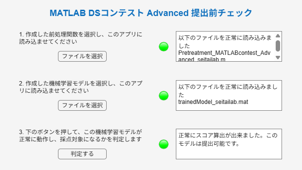

# 本番提出ファイル（チーム：生体情報処理研究室、ファイル用チーム名 seitailab）

提出する2つのファイルです。どちらも `build_submission.m` で作り、提出前チェックアプリと同じ確認を通しています。

| ファイル | 中身 |
|---|---|
| `Pretreatment_MATLABcontest_Advanced_seitailab.m` | 前処理関数。公式の雛形の「ここから下を編集してよい」〜「ここまでを編集してよい」の間だけに、32列の特徴量の計算を入れたもの |
| `trainedModel_seitailab.mat` | 変数 `trainedModel`（ガウスSVM、`model/final_ergonomic32_svm/trained.mat` と同じ） |

`Pretreatment_MATLABcontest_Advanced.m` は、コピー元の前処理関数です（公式ライブスクリプトの提出作業３と同じく、これを `copyfile` で名前を変えています）。

## 確かめた結果（2026-11-26、MATLAB R2026a）

- 学習用2941窓を前処理関数に通した出力で、学習時と同じ判定になる（正解率0.9976）
- チェックアプリと同じ手順（ファイル名の形、変数名 `trainedModel`、検証用407窓）で 400/407（0.9828）。合格の基準は0.5以上
- 1試行だけ渡したときの出力が、まとめて渡したときと一致する（差の最大 4.5×10⁻¹⁴）
- チェックアプリ本体（`data/production/DScontest_submitModelVerifier.mltbx`）でも、Step1〜3 のランプがすべて緑になる。Step3 の表示は「正常にスコア算出が出来ました。このモデルは提出可能です。」。このフォルダからでも、リポジトリの一番上のフォルダから起動しても同じ（画面は `check_app_result.png`）



## 作り直す・確かめる

MATLAB でこのフォルダを現在のフォルダにして実行します。

```matlab
cd submission/seitailab
build_submission
```

チェックアプリ（`DScontest_submitModelVerifier`）で確かめるときは、Step1 と Step2 でこのフォルダの2ファイルを選びます。アプリは前処理関数を読み込むときだけそのフォルダに移動するので、MATLAB の現在のフォルダはどこでも構いません。

アプリ本体での確認は、次のスクリプトでも繰り返せます。配布された `.mltbx` を一時フォルダに展開し、インストールせずにアプリを起動します。ボタンを押したときと同じ処理を順に呼び、ファイル選択の画面だけを、このフォルダのファイルを返す関数に差し替えています。

```matlab
cd submission/seitailab
check_with_app
```

## 提出

締め切りは 2026年11月27日（金）8:59 です。上の2ファイルとスライド（PowerPoint か PDF）を、ポータルサイトにある提出フォームから送ります。
